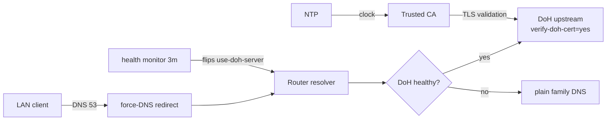

# mikrotik-doh-failover

<!-- md-i18n:switcher -->
**In anderen Sprachen:** [English](README.md) · Deutsch · [中文](README.zh.md) · [हिन्दी](README.hi.md) · [Español](README.es.md) · [Русский](README.ru.md)

**Ausfallsichere DNS-over-HTTPS-Konfiguration (DoH) für MikroTik RouterOS, als diffbare `.rsc`-Skripte.**

[**Doku**](docs/) · [**Releases**](https://github.com/paulmann/mikrotik-doh-failover/releases) · [**Changelog**](CHANGELOG.md) · [**Issues**](https://github.com/paulmann/mikrotik-doh-failover/issues) · [**Sicherheit**](SECURITY.md) · [**Für Agenten**](AGENTS.md)

[](LICENSE)
[](https://github.com/paulmann/mikrotik-doh-failover/releases)
[](https://help.mikrotik.com/docs/spaces/ROS/pages/37748767/DNS)


RouterOS leitet das DNS eines LAN über den Router, doch standardmäßig läuft dieser Upstream-Weg
im Klartext. Dieses Projekt konfiguriert einen **verifizierten** DoH-Upstream mit Klartext-DNS
als Rückfall, zwingt klassisches LAN-DNS auf den Router und ergänzt eine geplante
Zustandsprüfung, die bei Ausfall zwischen DoH und Klartext-DNS umschaltet. Es ist die
Begleitung „so reproduziert und pflegt man das“ zum Artikel
[«Архитектура отказоустойчивого DNS-over-HTTPS в RouterOS»](https://sysadministrator.ru/%d0%b0%d1%80%d1%85%d0%b8%d1%82%d0%b5%d0%ba%d1%82%d1%83%d1%80%d0%b0-%d0%be%d1%82%d0%ba%d0%b0%d0%b7%d0%be%d1%83%d1%81%d1%82%d0%be%d0%b9%d1%87%d0%b8%d0%b2%d0%be%d0%b3%d0%be-dns-over-https-%d0%b2-routeros/)
auf `sysadministrator.ru`.

> **Stand der Dokumentation.** Die Zahlen in dieser README wurden am 2026-10-22 (v0.1.0)
> am veröffentlichten Stand gemessen. Die ausführliche Begründung des Entwurfs steht in
> [`docs/`](docs/); die Skripte wurden auf RouterOS 7.23.1 und 7.24.5 geprüft.

---

> **0.2.0 (2026-10-26).** The default upstream is now the **standard** Cloudflare
> resolver (no filtering), the failover switches between two DoH endpoints instead
> of falling back to plain DNS, and the health check judges answers by content.
> Commands in this translation may predate that change — the canonical, current
> text is [README.md](README.md) and [docs/](docs/).

## Inhalt

- [Was das ist und warum](#was-das-ist-und-warum)
- [Funktionen](#funktionen)
- [In Zahlen](#in-zahlen)
- [So funktioniert es](#so-funktioniert-es)
- [Installation](#installation)
- [Erste Schritte](#erste-schritte)
- [Zuverlässigkeit und Grenzen](#zuverlässigkeit-und-grenzen)
- [Sicherheit](#sicherheit)
- [Anforderungen und Kompatibilität](#anforderungen-und-kompatibilität)
- [Dokumentation](#dokumentation)
- [Mitwirken](#mitwirken)
- [Lizenz](#lizenz)

---

## Was das ist und warum

Ein verbreiteter, aber kaputter Weg zu „DoH auf MikroTik“ ist, mehrere DoH-Server per
`/ip dns static-server type=doh` anzulegen und davon Ausfallsicherheit zu erwarten. Diese
Syntax existiert nicht und erzeugt keine Redundanz; RouterOS unterstützt genau **ein**
`use-doh-server`. Ein weiterer häufiger Fehler ist `verify-doh-cert=yes` ohne
vertrauenswürdige CA — dann stoppt die Namensauflösung still und ohne Meldung.

Dieses Projekt vermeidet beides:

- **ein aktiver DoH-Upstream**, mit schlichten `servers` als Bootstrap und Rückfall;
- **ein verwaltetes Failover**-Skript, das bei Ausfall `use-doh-server` leert und
  die Einstellung nach der Erholung wiederherstellt;
- **ein ausdrücklicher CA-Import** — geprüft, dass der eingebaute Trust Store die
  Cloudflare-Kette auf 7.23/7.24 nicht abdeckt;
- **statische A-Records für den Bootstrap**, damit der DoH-Hostname auch dann
  auflöst, wenn Klartext-DNS ausgefallen ist.

Jede Aussage in dieser README und in `docs/` wurde auf echten Geräten geprüft;
Version und `device-mode` sind dort genannt, wo das Verhalten abweicht.

## Funktionen

| Fähigkeit | Detail |
|---|---|
| Verschlüsselter Upstream | ein DoH-Upstream mit `verify-doh-cert=yes` |
| Rückfall | Klartext-Family-DNS (`1.1.1.3,1.0.0.3`), wenn DoH nicht erreichbar ist |
| Wiederherstellung | automatische Rückkehr zu DoH, sobald die Zustandsprüfung besteht |
| Bootstrap | statische A-Records für den DoH-Hostnamen |
| Klassisches DNS erzwingen | `dstnat redirect` für UDP/TCP 53 von der LAN-Bridge |
| Schutz des Resolvers | DNS aus dem WAN verwerfen, aus dem LAN annehmen (UDP und TCP) |
| Failover-Richtlinie | nur `read,write,policy,test` (kein `ftp`/`reboot`/`password`) |

## In Zahlen

Gemessen am veröffentlichten Stand vom 2026-10-22 (v0.1.0):

| Bereich | Anzahl | Gemessen in |
|---|---|---|
| RouterOS-Skripte | 7 | `routeros/` |
| Beispielkonfigurationen | 1 | `examples/` |
| Dokumente | 3 | `docs/` |
| Diagramme | 3 | `diagrams/` |
| Getestete Geräte | 5 | `docs/verification.md` |
| Getestete RouterOS-Versionen | 2 (7.23.1, 7.24.5) | `docs/verification.md` |

## So funktioniert es



| Komponente | Aufgabe |
|---|---|
| `00-install-ca.rsc` | Vertrauensanker für `verify-doh-cert=yes` |
| `01-configure-doh.rsc` | ein DoH-Upstream + Bootstrap + Rückfall |
| `02-security-policies.rsc` | klassisches DNS erzwingen + Schutz des Resolvers |
| `03-capsman.rsc` | gezielte CAPsMAN/DHCP-Integration |
| `04-cert-update.rsc` | optionales CA-Refresh |
| `05-dns-health-monitor.rsc` | Zustandsprüfung + Failover-Scheduler |

## Installation

Voraussetzungen:

- RouterOS **7.20+** (geprüft: 7.23.1, 7.24.5);
- synchronisierte NTP-Zeit;
- `device-mode` `advanced` für den automatischen Failover-**Scheduler**.

Schnellstart (Cloudflare Family):

```rsc
# 1. Upload certs/cloudflare-doh-ca.crt to the router, then:
/import file-name=00-install-ca.rsc
/import file-name=01-configure-doh.rsc
/import file-name=02-security-policies.rsc
/import file-name=05-dns-health-monitor.rsc
```

Für andere Anbieter (Quad9, Google, Cloudflare standard/security) die Werte in
[`routeros/config.example.rsc`](routeros/config.example.rsc) anpassen.

## Erste Schritte

```rsc
/ip dns cache flush
:put [:resolve example.com]     # real IP
:put [:resolve pornhub.com]     # 0.0.0.0 with the Family filter
/log print where message~"connection error"
```

## Zuverlässigkeit und Grenzen

| Situation | Verhalten |
|---|---|
| DoH nicht erreichbar | Failover-Skript wechselt auf Klartext-Family-DNS (protokolliert als `error`) |
| DoH erholt sich | Skript stellt DoH wieder her (protokolliert als `warning`) |
| DoH und Klartext beide ausgefallen | Skript behält die letzte Konfiguration und protokolliert `critical` |
| Client nutzt eigenes DoH/DoT | **nicht blockiert** (dokumentierte Grenze) |
| `device-mode=home` | Scheduler wird abgelehnt; Monitor von Hand starten |

### Scheduler abgelehnt: `not allowed by device-mode`

Auf Geräten mit `device-mode=home` (zum Beispiel dem hier getesteten RB4011iGS+)
lehnt RouterOS `/system scheduler add` und `/tool fetch` mit
`not allowed by device-mode` ab. Das ist eine erwartete Grenze von RouterOS und
kein Skriptfehler: DoH-Konfiguration und DNS-Erzwingung funktionieren weiter, aber
der Failover-Monitor lässt sich nur von Hand starten. Möglichkeiten:

1. `home` beibehalten und `/system script run DNS_HealthMonitor_Failover` von Hand starten;
2. auf `advanced` wechseln, um den Scheduler freizuschalten:
   ```rsc
   /system/device-mode/update device-mode=advanced
   ```
   danach die Änderung bestätigen und neu starten.

## Sicherheit

- Der Resolver verwirft DNS aus dem WAN und leitet nur klassisches DNS (53) um; dass Clients
  DoH (443) und DoT (853) umgehen können, ist dokumentiert und nicht verschwiegen.
- Wer Cloudflare/Quad9/Google wählt, vertraut diesem Dritten die eigenen Anfragen an; DoH
  verbirgt sie nur vor der lokalen Strecke.
- CA-Bootstrap nur aus vertrauenswürdiger Quelle; `check-certificate=no` gilt nur dort.
- Berichte und Sicherheitsmodell: siehe [SECURITY.md](SECURITY.md).

## Anforderungen und Kompatibilität

| Gerät | RouterOS | device-mode | WLAN-Stack | Ergebnis |
|---|---|---|---|---|
| Chateau PRO ax | 7.24.5 | advanced | klassisches `/caps-man` (Controller) | geprüft (Hub) |
| cAP ax | 7.24.5 | advanced | klassisches `/caps-man` (Client) | geprüft |
| RB4011iGS+ | 7.24.5 | home | — | geprüft; Scheduler blockiert |
| hAP ax² | 7.24.5 | advanced | — | geprüft |
| RB951Ui-2HnD | 7.24.5 | advanced | — | geprüft |
| RB2011UiAS | 7.23.1 | advanced | — | geprüft |

## Dokumentation

| Dokument | Inhalt |
|---|---|
| [`docs/architecture.md`](docs/architecture.md) | Entwurfsbegründung und Bedrohungsmodell |
| [`docs/verification.md`](docs/verification.md) | Prüfungen je Teilsystem + Checkliste für den Failover-Test |
| [`docs/troubleshooting.md`](docs/troubleshooting.md) | bekannte Fehler und Behelfe |
| [`routeros/config.example.rsc`](routeros/config.example.rsc) | alle einstellbaren Werte |

## Mitwirken

[CONTRIBUTING.md](CONTRIBUTING.md) lesen. Sicherheitsprobleme: [SECURITY.md](SECURITY.md),
niemals ein öffentliches Issue.

## Lizenz

[MIT](LICENSE) © 2026 Mikhail Deynekin.
