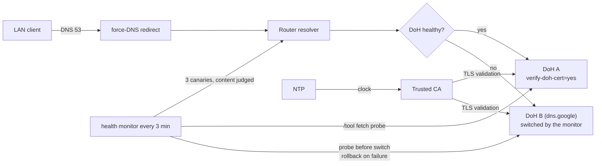

# mikrotik-doh-failover

<!-- md-i18n:switcher -->
**Auf anderen Sprachen lesen:** [English](README.md) · Deutsch · [中文](README.zh.md) · [हिन्दी](README.hi.md) · [Español](README.es.md) · [Русский](README.ru.md)

**Failover-Konfiguration für DNS-over-HTTPS (DoH) unter MikroTik RouterOS, als diffbare `.rsc`-Skripte.**

[**Doku**](docs/) · [**Releases**](https://github.com/paulmann/mikrotik-doh-failover/releases) · [**Changelog**](CHANGELOG.md) · [**Issues**](https://github.com/paulmann/mikrotik-doh-failover/issues) · [**Sicherheit**](SECURITY.md) · [**Für Agenten**](AGENTS.md)

[](LICENSE)
[](https://github.com/paulmann/mikrotik-doh-failover/releases)
[](https://help.mikrotik.com/docs/spaces/ROS/pages/37748767/DNS)


RouterOS leitet das DNS eines LANs durch den Router, aber standardmäßig ist diese
Upstream-Strecke Klartext. Dieses Projekt konfiguriert einen **verifizierten**
DoH-Upstream mit einem zweiten verifizierten DoH-Endpunkt als Failover, zwingt
klassisches LAN-DNS auf den Router und ergänzt eine geplante Zustandsprüfung, die
bei einem Ausfall den Endpunkt wechselt. Es ist die Begleitung „nachbauen und
pflegen“ zum Artikel
[«Архитектура отказоустойчивого DNS-over-HTTPS в RouterOS»](https://sysadministrator.ru/%d0%b0%d1%80%d1%85%d0%b8%d1%82%d0%b5%d0%ba%d1%82%d1%83%d1%80%d0%b0-%d0%be%d1%82%d0%ba%d0%b0%d0%b7%d0%be%d1%83%d1%81%d1%82%d0%be%d0%b9%d1%87%d0%b8%d0%b2%d0%be%d0%b3%d0%be-dns-over-https-%d0%b2-routeros/)
auf `sysadministrator.ru`.

> **Stand der Dokumentation.** Abgedeckte Version: **0.2.0** (Tag `v0.2.0`,
> 2026-10-26). Die Zahlen in „In Zahlen“ wurden mit `git ls-files` und
> `Get-ChildItem` auf `main` am 2026-10-26 gemessen, nach dem
> Dokumentationsdurchgang zu 0.2.0. Das
> Verhalten wurde auf RouterOS 7.23.1 und 7.24.5 geprüft; alles, was nicht auf
> einem Gerät geprüft wurde, ist im Text als solches gekennzeichnet, und
> `device-mode` wird überall dort genannt, wo es das Ergebnis ändert.

---

## Inhalt

- [Was das ist und warum](#was-das-ist-und-warum)
- [Was sich in 0.2.0 geändert hat](#was-sich-in-020-geändert-hat)
- [Fähigkeiten](#fähigkeiten)
- [In Zahlen](#in-zahlen)
- [Funktionsweise](#funktionsweise)
- [Installation](#installation)
- [Erste Schritte](#erste-schritte)
- [Zuverlässigkeit und Grenzen](#zuverlässigkeit-und-grenzen)
- [Sicherheit](#sicherheit)
- [Voraussetzungen und Kompatibilität](#voraussetzungen-und-kompatibilität)
- [Dokumentation](#dokumentation)
- [Mitwirken](#mitwirken)
- [Lizenz](#lizenz)

---

## Was das ist und warum

Ein verbreiteter, kaputter Ansatz für „DoH auf MikroTik“ ist, mehrere DoH-Server
über `/ip dns static-server type=doh` anzulegen und Failover zu erwarten. Diese
Syntax existiert nicht und erzeugt keine Redundanz; RouterOS unterstützt genau
**einen** `use-doh-server`. Ein weiterer häufiger Fehler ist
`verify-doh-cert=yes` ohne vertrauenswürdige CA, was die gesamte
Namensauflösung stillschweigend stoppt.

Dieses Projekt vermeidet beides:

- **ein aktiver DoH-Upstream** — standardmäßig Cloudflare ohne Filterung;
  einfache `servers` dienen nur dem Bootstrap und werden nie als
  funktionierender Fallback genutzt;
- **ein verwaltetes Failover**-Skript, das bei einem Ausfall auf einen zweiten
  DoH-Endpunkt wechselt, den Wechsel prüft und nach der Erholung zum primären
  zurückkehrt;
- **ein ausdrücklicher CA-Import** — geprüft, dass der eingebaute Trust-Store
  die Cloudflare-Kette auf 7.23/7.24 nicht abdeckt;
- **statische A-Records als Bootstrap für beide Endpunkt-Hosts**, damit die
  Zustandsprüfung sie noch erreicht, wenn der Resolver selbst tot ist.

## Was sich in 0.2.0 geändert hat

Version 0.1.0 war auf eine Weise falsch, die im Feld zählte: Sie meldete den
Resolver als gesund, wenn die Antwort das Paar `8.6.112.0` / `8.47.69.0` war,
das mehrere Netze nicht erreichen können — Seiten öffneten nicht mehr, während
der Monitor „alles in Ordnung“ meldete. 0.2.0 ändert fünf Dinge (Volltext:
[`docs/release-notes-v0.2.0.md`](docs/release-notes-v0.2.0.md)):

| Änderung | Vorher (0.1.0) | Jetzt (0.2.0) |
|---|---|---|
| Standard-Upstream | Cloudflare Family (`family.cloudflare-dns.com`, Filterung) | Cloudflare **Standard** (`cloudflare-dns.com`, 1.1.1.1/1.0.0.1); Filterung ist optional |
| Failover-Ziel | Fallback auf einfaches DNS | ein zweiter **DoH**-Endpunkt (`dns.google`) |
| Zustandsprüfung | jede gültige IP galt als gesund | **Inhalt** der Antwort wird über drei Kanarien bewertet |
| Endpunkt-Probe | schaltete `use-doh-server` um (LAN verlor DoH bei jeder Prüfung) | `/tool fetch` gegen die DNS-JSON-API, `/ip dns` bleibt unberührt |
| Fehlgeschlagenes Failover | Router blieb auf einem toten Endpunkt | vorher geprüft, nachher verifiziert, bei Fehler zurückgerollt |

Der Wechsel von 0.1.0 erfordert zwei Schritte über das Kopieren der Skripte
hinaus: die alten State-Globals (`DNSMonitorState`, `DNSFailoverAttempts`)
löschen und ausdrücklich entscheiden, ob die Filterung zurückkommen soll — dafür
braucht es die Family-URL, die passenden `servers` und das CA aus
`examples/cloudflare-family.rsc`. Das Flag `filtering` in
`05-dns-health-monitor.rsc` ist nur eine Notiz für den Leser: das Skript
deklariert es und liest es nie, deshalb hängt weder Verhalten noch Logzeile davon
ab (gemessen am 2026-10-26). Das Global `DNSCurrentMode` aus 0.1.0
existiert nicht mehr.

## Fähigkeiten

| Fähigkeit | Detail |
|---|---|
| Verschlüsselter Upstream | ein DoH-Upstream mit `verify-doh-cert=yes` |
| Fallback | ein zweiter **DoH**-Endpunkt (Google), wenn der primäre nicht erreichbar ist |
| Rückkehr | automatische Rückkehr zum primären, sobald die Zustandsprüfung besteht |
| Zustandsprüfung | bewertet die ANSWER (Inhalt), nicht den Typ; prüft Endpunkte mit `/tool fetch` |
| Bootstrap | statische A-Records für beide Endpunkt-Hostnamen |
| Klassisches DNS erzwingen | `dstnat redirect` von UDP/TCP 53 aus der LAN-Bridge |
| Schutz des Resolvers | DNS aus dem WAN verwerfen, aus dem LAN annehmen (UDP und TCP) |
| Failover-Richtlinie | nur `read,write,policy,test` (kein `ftp`/`reboot`/`password`) |
| Flotten-Monitoring | Zabbix-8-Collector für DoH- und VPN-Zustand über SSH — `zabbix/`, auf `main` nach dem Tag `v0.2.0` |

## In Zahlen

Gemessen auf `main`, 2026-10-26:

| Bereich | Anzahl | Gemessen aus |
|---|---|---|
| RouterOS-Skripte | 7 (360 Zeilen) | `routeros/*.rsc` |
| Beispielkonfigurationen | 2 | `examples/*.rsc` |
| Dokumente | 5 | `docs/*.md` |
| Diagramme | 3 | `diagrams/*.mmd` |
| README-Sprachen | 6 | `README*.md` |
| Von git verfolgte Dateien | 38 | `git ls-files` |
| Getestete Geräte | 6 | `docs/verification.md`, Tabelle unten |
| Getestete RouterOS-Versionen | 2 (7.23.1, 7.24.5) | `docs/verification.md` |
| Zabbix-Objekte | 8 Items, 5 Trigger, 2 Service-Bäume | `zabbix/doh-zabbix-setup.py` |

Das Tag `v0.2.0` selbst enthält 32 Dateien; alles unter `zabbix/` wurde nach dem
Tag committet und ist damit auf `main` bis zur nächsten Version unveröffentlicht.

## Funktionsweise



Der Monitor schaltet `use-doh-server` nie um, um einen Endpunkt zu testen: Die
Probe ist eine HTTPS-Anfrage aus `/tool fetch`, sodass eine Routineprüfung
`/ip dns` unberührt lässt. Die Zustandsmaschine (Diagramm:
[`diagrams/dns-failover.mmd`](diagrams/dns-failover.mmd)) ist `healthy` → `stub`
→ `dead` → `failoverB` und protokolliert nur Übergänge.

| Komponente | Aufgabe |
|---|---|
| `00-install-ca.rsc` | Vertrauensanker für `verify-doh-cert=yes` |
| `01-configure-doh.rsc` | ein DoH-Upstream + Bootstrap für beide Endpunkt-Hosts |
| `02-security-policies.rsc` | klassisches DNS erzwingen + Schutz des Resolvers |
| `03-capsman.rsc` | gezielte CAPsMAN/DHCP-Integration |
| `04-cert-update.rsc` | optionales Auffrischen der CA |
| `05-dns-health-monitor.rsc` | Inhaltsprüfung + DoH-zu-DoH-Failover (`maxAttempts=3`) |

## Installation

Voraussetzungen:

- RouterOS **7.20+** wie deklariert; Verhalten nur auf **7.23.1** und
  **7.24.5** geprüft;
- NTP synchronisiert;
- `device-mode` `advanced` für den automatischen Failover-**Scheduler**.

Schnellstart (Cloudflare Standard, keine Filterung — der Standard seit 0.2.0):

```rsc
# 1. Upload certs/cloudflare-doh-ca.crt to the router, then:
/import file-name=00-install-ca.rsc
/import file-name=01-configure-doh.rsc
/import file-name=02-security-policies.rsc
/import file-name=05-dns-health-monitor.rsc
```

Für andere Anbieter (Quad9, Google, Cloudflare Standard/Security) die Werte in
[`routeros/config.example.rsc`](routeros/config.example.rsc) anpassen. Rohe URLs
auf `v0.2.0` (oder einen Commit) zu pinnen ist sicherer als `main`; `main` ist
dem Tag voraus.

## Erste Schritte

```rsc
/ip dns cache flush
:put [:resolve example.com]     # expect 104.20.x / 172.66.x
                                # 8.6.112.0 / 8.47.69.0 is the "stub pair", not an outage:
                                # see docs/troubleshooting.md §6.10
:put [:resolve pornhub.com]     # a real IP with the standard resolver;
                                # 0.0.0.0 only with Family/Security
/log print where message~"connection error"
```

## Zuverlässigkeit und Grenzen

| Situation | Verhalten |
|---|---|
| DoH nicht erreichbar | Monitor wechselt auf das Fallback-DoH, verifiziert es, rollt bei Fehler zurück (protokolliert `error`/`warning`) |
| DoH erholt sich | Monitor kehrt zum primären zurück (protokolliert `warning`) |
| Beide Endpunkte down | Monitor behält die aktuelle Konfiguration und protokolliert `error` einmal |
| Antworten sind das Stub-Paar | Monitor protokolliert es einmal und führt **kein** Failover aus — ein zweiter Endpunkt liefert dasselbe Paar (§6.10) |
| Uhr ist falsch | Monitor protokolliert `clock looks wrong …` und stoppt, weil Zertifikatsprüfung bei falschem Datum nicht gelingen kann |
| Failover scheitert wiederholt | höchstens 3 Versuche pro Ausfall, danach wartet der Monitor auf die Erholung des primären, statt das Log zu füllen |
| Client nutzt eigenes DoH/DoT | **nicht blockiert** (dokumentierte Grenze) |
| `device-mode=home` | `fetch` und der Scheduler werden abgelehnt; Monitor von Hand starten |

### Scheduler abgelehnt: `not allowed by device-mode`

Auf Geräten mit `device-mode=home` (zum Beispiel dem hier getesteten RB4011iGS+)
lehnt RouterOS `/system scheduler add` und `/tool fetch` mit
`not allowed by device-mode` ab. Das ist eine erwartete Grenze von RouterOS, kein
Skriptfehler: DoH-Konfiguration und Force-DNS funktionieren weiterhin, aber der
Failover-Monitor lässt sich nur von Hand starten, und ohne `fetch` kann er
Endpunkte überhaupt nicht prüfen — er behält dann die aktuelle Konfiguration.

1. `home` verlassen und `/system script run DNS_HealthMonitor_Failover` von Hand ausführen;
2. auf `advanced` wechseln, um den Scheduler zu aktivieren:
   ```rsc
   /system/device-mode/update device-mode=advanced
   ```
   dann die Änderung bestätigen und neu starten.

## Sicherheit

- Der Resolver verwirft DNS aus dem WAN und leitet nur klassisches DNS (53) um;
  dass Clients DoH (443) und DoT (853) umgehen können, ist dokumentiert, nicht
  versteckt.
- Cloudflare/Quad9/Google zu wählen heißt, diesem Dritten die eigenen Abfragen
  anzuvertrauen; DoH verbirgt sie nur vor der lokalen Strecke.
- Der CA-Bootstrap muss eine vertrauenswürdige Quelle nutzen;
  `check-certificate=no` gilt nur für den Bootstrap.
- Das Failover-Ziel muss ein DoH-Endpunkt sein, der die DNS-JSON-API
  beantwortet — ein Quad9-Fallback sähe immer unerreichbar aus
  (`docs/troubleshooting.md` §6.12).
- Meldung von Sicherheitsproblemen und das Sicherheitsmodell: siehe
  [SECURITY.md](SECURITY.md).

## Voraussetzungen und Kompatibilität

| Gerät | RouterOS | device-mode | WLAN-Stack | Ergebnis |
|---|---|---|---|---|
| Chateau PRO ax | 7.24.5 | advanced | legacy `/caps-man` (Controller) | verifiziert (Hub) |
| cAP ax | 7.24.5 | advanced | legacy `/caps-man` (Client) | verifiziert |
| RB4011iGS+ | 7.24.5 | home | — | verifiziert; Scheduler blockiert |
| hAP ax² | 7.24.5 | advanced | — | verifiziert |
| RB951Ui-2HnD | 7.24.5 | advanced | — | verifiziert |
| RB2011UiAS | 7.23.1 | advanced | — | verifiziert |

## Dokumentation

| Dokument | Inhalt |
|---|---|
| [`docs/architecture.md`](docs/architecture.md) | Entwurfsbegründung, Zustandstabelle, Bedrohungsmodell |
| [`docs/verification.md`](docs/verification.md) | Prüfungen je Teilsystem + acht Failover-Szenarien |
| [`docs/troubleshooting.md`](docs/troubleshooting.md) | bekannte Fehler und Workarounds, inklusive §6.10 (Stub-Paar) |
| [`docs/release-notes-v0.2.0.md`](docs/release-notes-v0.2.0.md) | was 0.2.0 geändert hat und die Messungen dahinter |
| [`zabbix/README.md`](zabbix/README.md) | Flotten-Monitoring in Zabbix: DoH- und VPN-Zustand, Trigger, Service-Baum |
| [`routeros/config.example.rsc`](routeros/config.example.rsc) | alle einstellbaren Werte |
| [`AGENTS.md`](AGENTS.md) | derselbe Vertrag, für einen maschinellen Aufrufer geschrieben |

## Mitwirken

Lies [CONTRIBUTING.md](CONTRIBUTING.md). Sicherheitsprobleme:
[SECURITY.md](SECURITY.md), niemals ein öffentliches Issue.

## Lizenz

[MIT](LICENSE) © 2026 Mikhail Deynekin.
