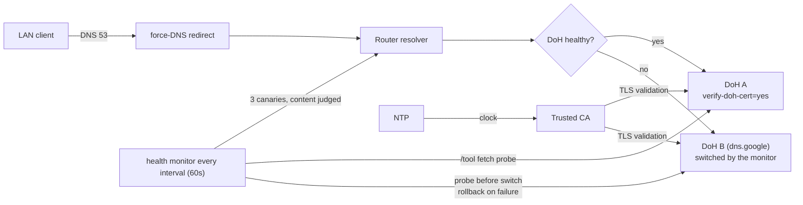

# mikrotik-doh-failover

<!-- md-i18n:switcher -->
**Lee esto en:** [English](README.md) · [Deutsch](README.de.md) · [中文](README.zh.md) · [हिन्दी](README.hi.md) · Español · [Русский](README.ru.md)

**Configuración de DNS-over-HTTPS (DoH) con failover para MikroTik RouterOS, en forma de scripts `.rsc` comparables con diff.**

[**Docs**](docs/) · [**Versiones**](https://github.com/paulmann/mikrotik-doh-failover/releases) · [**Registro de cambios**](CHANGELOG.md) · [**Incidencias**](https://github.com/paulmann/mikrotik-doh-failover/issues) · [**Seguridad**](SECURITY.md) · [**Para agentes**](AGENTS.md)

[](LICENSE)
[](https://github.com/paulmann/mikrotik-doh-failover/releases)
[](https://help.mikrotik.com/docs/spaces/ROS/pages/37748767/DNS)


RouterOS enruta el DNS de una LAN a través del router, pero por defecto ese tramo
ascendente va en texto plano. Este proyecto configura un upstream DoH
**verificado** con un segundo endpoint DoH verificado como failover, fuerza el
DNS clásico de la LAN hacia el router y añade una comprobación de salud
programada que cambia de endpoint ante un fallo. Es el complemento «cómo
reproducir y mantener» del artículo
[«Архитектура отказоустойчивого DNS-over-HTTPS в RouterOS»](https://sysadministrator.ru/%d0%b0%d1%80%d1%85%d0%b8%d1%82%d0%b5%d0%ba%d1%82%d1%83%d1%80%d0%b0-%d0%be%d1%82%d0%ba%d0%b0%d0%b7%d0%be%d1%83%d1%81%d1%82%d0%be%d0%b9%d1%87%d0%b8%d0%b2%d0%be%d0%b3%d0%be-dns-over-https-%d0%b2-routeros/)
en `sysadministrator.ru`.

> **Estado de la documentación.** Versión cubierta: **0.4.0** (en `main`, última etiqueta `v0.3.1`),
> 2026-10-26). Los recuentos de «En cifras» se midieron con `git ls-files` y
> `Get-ChildItem` sobre `main` el 2026-10-26, tras la pasada de documentación
> de 0.2.0. El
> comportamiento se verificó en RouterOS 7.23.1 y 7.24.5; todo lo que no está
> verificado en un dispositivo se marca como tal en el texto, y se nombra
> `device-mode` allí donde cambia el resultado.

---

## Contenido

- [Qué es esto y por qué](#qué-es-esto-y-por-qué)
- [Qué cambió en 0.2.0](#qué-cambió-en-020)
- [Capacidades](#capacidades)
- [En cifras](#en-cifras)
- [Cómo funciona](#cómo-funciona)
- [Instalación](#instalación)
- [Primeros pasos](#primeros-pasos)
- [Fiabilidad y límites](#fiabilidad-y-límites)
- [Seguridad](#seguridad)
- [Requisitos y compatibilidad](#requisitos-y-compatibilidad)
- [Documentación](#documentación)
- [Contribuir](#contribuir)
- [Licencia](#licencia)

---

## Qué es esto y por qué

Un enfoque roto habitual para «DoH en MikroTik» es añadir varios servidores DoH
con `/ip dns static-server type=doh` y esperar failover. Esa sintaxis no existe y
no produce redundancia; RouterOS admite exactamente **un** `use-doh-server`. Otro
fallo frecuente es `verify-doh-cert=yes` sin una CA de confianza, que detiene
toda la resolución en silencio.

Este proyecto evita ambas cosas:

- **un solo upstream DoH activo** — Cloudflare estándar por defecto, sin
  filtrado; los `servers` en texto plano son solo bootstrap y nunca se usan como
  respaldo operativo;
- **un script de failover gestionado** que cambia a un segundo endpoint DoH ante
  un fallo, verifica el cambio y vuelve al primario tras la recuperación;
- **una importación explícita de CA** — verificado que el almacén de confianza
  integrado no cubre la cadena de Cloudflare en 7.23/7.24;
- **registros A estáticos de bootstrap para los dos hosts de endpoint**, para que
  la sonda de salud pueda alcanzarlos incluso cuando el resolver está muerto.

## Qué cambió en 0.4.0

- La prueba del endpoint se ejecuta en memoria: `/tool fetch ... as-value output=user`, sin archivos temporales en `/file` ni carreras de limpieza. La comprobación JSON acepta `"Status":0` y `"Status": 0`.
- El failover es una cadena ordenada: primary → secondary → tertiary (`dohUrlC`, opcional) → plain DNS (`plainFallback`, desactivado por defecto).
- Nuevo estado `plain` (último recurso plain DNS), log `PRIVACY DEGRADED` y vuelta al primary.

## Qué cambió en 0.2.0

La versión 0.1.0 estaba equivocada de una manera que importaba en campo: daba el
resolver por sano cuando la respuesta era el par `8.6.112.0` / `8.47.69.0`, que
varias redes no pueden alcanzar — las páginas dejaban de abrirse mientras el
monitor informaba «todo bien». La 0.2.0 cambia cinco cosas (texto completo:
[`docs/release-notes-v0.2.0.md`](docs/release-notes-v0.2.0.md)):

| Cambio | Antes (0.1.0) | Ahora (0.2.0) |
|---|---|---|
| Upstream por defecto | Cloudflare Family (`family.cloudflare-dns.com`, con filtrado) | Cloudflare **estándar** (`cloudflare-dns.com`, 1.1.1.1/1.0.0.1); el filtrado es opcional |
| Objetivo del failover | respaldo a DNS en texto plano | un segundo endpoint **DoH** (`dns.google`) |
| Comprobación de salud | cualquier IP válida contaba como sana | se juzga el **contenido** de la respuesta con tres canarios |
| Sonda del endpoint | cambiaba `use-doh-server` (la LAN perdía DoH en cada comprobación) | `/tool fetch` contra la API DNS-JSON, `/ip dns` intacto |
| Failover fallido | el router quedaba en un endpoint muerto | se sondea antes, se verifica después y se revierte si falla |

Actualizar desde 0.1.0 requiere dos pasos además de copiar los scripts: borrar
las globales de estado antiguas (`DNSMonitorState`, `DNSFailoverAttempts`) y
decidir explícitamente si quieres recuperar el filtrado: eso significa la URL
Family, los `servers` correspondientes y el CA de
`examples/cloudflare-family.rsc`. El flag `filtering` de
`05-dns-health-monitor.rsc` es solo una nota para el lector: el script lo declara y
nunca lo lee, así que ni el comportamiento ni el log dependen de él (medido el
2026-10-26). La global `DNSCurrentMode` de 0.1.0 ya no existe.

## Capacidades

| Capacidad | Detalle |
|---|---|
| Upstream cifrado | un upstream DoH con `verify-doh-cert=yes` |
| Respaldo | un segundo endpoint **DoH** (Google) cuando el primario es inalcanzable |
| Recuperación | vuelta automática al primario cuando pasa la comprobación de salud |
| Comprobación de salud | juzga la RESPUESTA (contenido), no el tipo; sondea los endpoints con `/tool fetch` |
| Bootstrap | registros A estáticos para los dos nombres de host de endpoint |
| Forzar DNS clásico | `dstnat redirect` de UDP/TCP 53 desde el bridge de la LAN |
| Protección del resolver | descarta DNS desde WAN, acepta desde LAN (UDP y TCP) |
| Política del failover | solo `read,write,policy,test` (sin `ftp`/`reboot`/`password`) |
| Monitorización del parque | colector Zabbix 8 para el estado de DoH y VPN por SSH — `zabbix/`, en `main` después de la etiqueta `v0.2.0` |

## En cifras

Medido sobre `main`, 2026-10-26:

| Superficie | Recuento | Medido desde |
|---|---|---|
| Scripts de RouterOS | 7 (360 líneas) | `routeros/*.rsc` |
| Configuraciones de ejemplo | 2 | `examples/*.rsc` |
| Documentos | 5 | `docs/*.md` |
| Diagramas | 3 | `diagrams/*.mmd` |
| Idiomas del README | 6 | `README*.md` |
| Archivos seguidos por git | 38 | `git ls-files` |
| Dispositivos probados | 6 | `docs/verification.md`, tabla más abajo |
| Versiones de RouterOS probadas | 2 (7.23.1, 7.24.5) | `docs/verification.md` |
| Objetos de Zabbix | 8 elementos, 5 disparadores, 2 árboles de servicio | `zabbix/doh-zabbix-setup.py` |

La etiqueta `v0.2.0` contiene 32 archivos; todo lo que hay en `zabbix/` se
confirmó después de la etiqueta y por tanto no está publicado en `main` hasta la
próxima versión.

## Cómo funciona



El monitor nunca conmuta `use-doh-server` para probar un endpoint: la sonda es
una petición HTTPS desde `/tool fetch`, así que una comprobación rutinaria deja
`/ip dns` en paz. La máquina de estados (diagrama:
[`diagrams/dns-failover.mmd`](diagrams/dns-failover.mmd)) es
`healthy` → `suspect` → `fallback` → `recovering` → `healthy`; además `stub`, `plain`, `degraded`, `clock-invalid`, `manual-only` (estados límite); y se registra solo en las transiciones.

| Componente | Responsabilidad |
|---|---|
| `00-install-ca.rsc` | ancla de confianza para `verify-doh-cert=yes` |
| `01-configure-doh.rsc` | un upstream DoH + bootstrap para los dos hosts de endpoint |
| `02-security-policies.rsc` | forzar DNS clásico + protección del resolver |
| `03-capsman.rsc` | integración puntual de CAPsMAN/DHCP |
| `04-cert-update.rsc` | refresco opcional de la CA |
| `05-dns-health-monitor.rsc` | comprobación de contenido + failover DoH a DoH (`maxAttempts=3`) |

## Instalación

Requisitos:

- RouterOS **7.20+** según lo declarado; comportamiento verificado solo en
  **7.23.1** y **7.24.5**;
- NTP sincronizado;
- `device-mode` `advanced` para el **programador** de failover automático.

Inicio rápido (Cloudflare estándar, sin filtrado — el valor por defecto desde
0.2.0):

```rsc
# 1. Upload certs/cloudflare-doh-ca.crt to the router, then:
/import file-name=00-install-ca.rsc
/import file-name=01-configure-doh.rsc
/import file-name=02-security-policies.rsc
/import file-name=05-dns-health-monitor.rsc
```

Para otros proveedores (Quad9, Google, Cloudflare standard/security) edita los
valores en [`routeros/config.example.rsc`](routeros/config.example.rsc). Fijar
las URL sin procesar a `v0.2.0` (o a un commit) es más seguro que `main`; `main`
va por delante de la etiqueta.

## Primeros pasos

```rsc
/ip dns cache flush
:put [:resolve example.com]     # expect 104.20.x / 172.66.x
                                # 8.6.112.0 / 8.47.69.0 is the "stub pair", not an outage:
                                # see docs/troubleshooting.md §6.10
:put [:resolve pornhub.com]     # a real IP with the standard resolver;
                                # 0.0.0.0 only with Family/Security
/log print where message~"connection error"
```

## Fiabilidad y límites

| Situación | Comportamiento |
|---|---|
| DoH inalcanzable | el monitor cambia al DoH de respaldo, lo verifica y revierte si falla (registra `error`/`warning`) |
| DoH se recupera | el monitor vuelve al primario (registra `warning`) |
| Ambos endpoints caídos | el monitor mantiene la configuración actual y registra `error` una vez |
| Las respuestas son el par stub | el monitor lo registra una vez y **no** hace failover — un segundo endpoint devuelve el mismo par (§6.10) |
| El reloj está mal | el monitor registra `clock looks wrong …` y se detiene, porque la validación de certificados no puede tener éxito con una fecha incorrecta |
| El failover falla una y otra vez | como máximo 3 intentos por caída; después el monitor espera a que el primario se recupere en lugar de llenar el registro |
| El cliente usa su propio DoH/DoT | **no se bloquea** (límite documentado) |
| `device-mode=home` | `fetch` y el programador son rechazados; ejecuta el monitor a mano |

### Programador rechazado: `not allowed by device-mode`

En dispositivos con `device-mode=home` (por ejemplo el RB4011iGS+ probado aquí),
RouterOS rechaza `/system scheduler add` y `/tool fetch` con
`not allowed by device-mode`. Es un límite esperado de RouterOS, no un defecto
del script: la configuración DoH y el forzado de DNS siguen funcionando, pero el
monitor de failover solo puede ejecutarse a mano, y sin `fetch` no puede sondear
endpoints en absoluto — entonces mantiene la configuración actual.

1. sal de `home` y ejecuta `/system script run DNS_HealthMonitor_Failover` a mano;
2. cambia a `advanced` para habilitar el programador:
   ```rsc
   /system/device-mode/update device-mode=advanced
   ```
   luego confirma el cambio y reinicia.

## Seguridad

- El resolver descarta DNS desde WAN y solo redirige el DNS clásico (53); el
  bypass de DoH (443) y DoT (853) del cliente está documentado, no oculto.
- Elegir Cloudflare/Quad9/Google significa confiar tus consultas a ese tercero;
  DoH solo las oculta del enlace local.
- El bootstrap de la CA debe usar una fuente de confianza; `check-certificate=no`
  es solo para el bootstrap.
- El objetivo del failover debe ser un endpoint DoH que responda a la API
  DNS-JSON — un respaldo Quad9 siempre parecería inalcanzable
  (`docs/troubleshooting.md` §6.12).
- Consulta [SECURITY.md](SECURITY.md) para reportar y para el modelo de seguridad.

## Requisitos y compatibilidad

| Dispositivo | RouterOS | device-mode | Pila inalámbrica | Resultado |
|---|---|---|---|---|
| Chateau PRO ax | 7.24.5 | advanced | legacy `/caps-man` (controller) | verificado (hub) |
| cAP ax | 7.24.5 | advanced | legacy `/caps-man` (client) | verificado |
| RB4011iGS+ | 7.24.5 | home | — | verificado; programador bloqueado |
| hAP ax² | 7.24.5 | advanced | — | verificado |
| RB951Ui-2HnD | 7.24.5 | advanced | — | verificado |
| RB2011UiAS | 7.23.1 | advanced | — | verificado |

## Documentación

| Documento | Contenido |
|---|---|
| [`docs/architecture.md`](docs/architecture.md) | justificación del diseño, tabla de estados, modelo de amenazas |
| [`docs/verification.md`](docs/verification.md) | comprobaciones por subsistema + ocho escenarios de failover |
| [`docs/troubleshooting.md`](docs/troubleshooting.md) | fallos conocidos y soluciones, incluido §6.10 (par stub) |
| [`docs/release-notes-v0.2.0.md`](docs/release-notes-v0.2.0.md) | qué cambió en 0.2.0 y las mediciones que lo respaldan |
| [`zabbix/README.md`](zabbix/README.md) | monitorización de parque en Zabbix: estado de DoH y VPN, disparadores, árbol de servicios |
| [`routeros/config.example.rsc`](routeros/config.example.rsc) | todos los valores ajustables |
| [`AGENTS.md`](AGENTS.md) | el mismo contrato escrito para un llamador máquina |

## Contribuir

Lee [CONTRIBUTING.md](CONTRIBUTING.md). Problemas de seguridad:
[SECURITY.md](SECURITY.md), nunca una incidencia pública.

## Licencia

[MIT](LICENSE) © 2026 Mikhail Deynekin.
