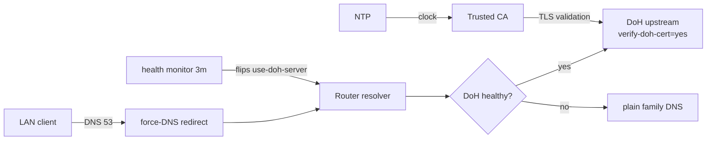

# mikrotik-doh-failover

<!-- md-i18n:switcher -->
**En otros idiomas:** [English](README.md) · [Deutsch](README.de.md) · [中文](README.zh.md) · [हिन्दी](README.hi.md) · Español · [Русский](README.ru.md)

**Configuración de DNS-over-HTTPS (DoH) con conmutación por error para MikroTik RouterOS, como scripts `.rsc` comparables con diff.**

[**Documentación**](docs/) · [**Versiones**](https://github.com/paulmann/mikrotik-doh-failover/releases) · [**Registro de cambios**](CHANGELOG.md) · [**Incidencias**](https://github.com/paulmann/mikrotik-doh-failover/issues) · [**Seguridad**](SECURITY.md) · [**Para agentes**](AGENTS.md)

[](LICENSE)
[](https://github.com/paulmann/mikrotik-doh-failover/releases)
[](https://help.mikrotik.com/docs/spaces/ROS/pages/37748767/DNS)


RouterOS encamina el DNS de una LAN a través del router, pero por defecto ese tramo
upstream va en claro. Este proyecto configura **un** upstream DoH **verificado** con
respaldo de DNS en claro, fuerza el DNS clásico de la LAN hacia el router y añade una
comprobación de estado programada que alterna entre DoH y DNS en claro cuando hay un
fallo. Es el complemento «cómo reproducirlo y mantenerlo» del artículo
[«Архитектура отказоустойчивого DNS-over-HTTPS в RouterOS»](https://sysadministrator.ru/%d0%b0%d1%80%d1%85%d0%b8%d1%82%d0%b5%d0%ba%d1%82%d1%83%d1%80%d0%b0-%d0%be%d1%82%d0%ba%d0%b0%d0%b7%d0%be%d1%83%d1%81%d1%82%d0%be%d0%b9%d1%87%d0%b8%d0%b2%d0%be%d0%b3%d0%be-dns-over-https-%d0%b2-routeros/)
en `sysadministrator.ru`.

> **Estado de la documentación.** Las cifras de este README se midieron sobre el
> árbol publicado el 2026-10-22 (v0.1.0). El razonamiento de diseño extenso está en
> [`docs/`](docs/); los scripts se verificaron en RouterOS 7.23.1 y 7.24.5.

---

> **0.2.0 (2026-10-26).** The default upstream is now the **standard** Cloudflare
> resolver (no filtering), the failover switches between two DoH endpoints instead
> of falling back to plain DNS, and the health check judges answers by content.
> Commands in this translation may predate that change — the canonical, current
> text is [README.md](README.md) and [docs/](docs/).

## Contenido

- [Qué es y por qué](#qué-es-y-por-qué)
- [Capacidades](#capacidades)
- [En cifras](#en-cifras)
- [Cómo funciona](#cómo-funciona)
- [Instalación](#instalación)
- [Primeros pasos](#primeros-pasos)
- [Fiabilidad y límites](#fiabilidad-y-límites)
- [Seguridad](#seguridad)
- [Requisitos y compatibilidad](#requisitos-y-compatibilidad)
- [Documentación](#documentación)
- [Contribuir](#contribuir)
- [Licencia](#licencia)

---

## Qué es y por qué

Un enfoque habitual y roto para «DoH en MikroTik» es añadir varios servidores DoH
mediante `/ip dns static-server type=doh` y esperar de ahí la redundancia. Esa
sintaxis no existe y no produce redundancia; RouterOS admite exactamente **un**
`use-doh-server`. Otro fallo habitual es `verify-doh-cert=yes` sin una CA de
confianza, que detiene toda la resolución sin avisar.

Este proyecto evita ambos:

- **un solo upstream DoH activo**, con `servers` en claro como arranque y respaldo;
- **un script de conmutación gestionada** que vacía `use-doh-server` al fallar y lo
  restaura tras la recuperación;
- **una importación explícita de la CA**: está verificado que el almacén de
  confianza incorporado no cubre la cadena de Cloudflare en 7.23/7.24;
- **registros A estáticos de arranque**, para que el nombre del host DoH resuelva
  incluso si el DNS en claro está caído.

Cada afirmación de este README y de `docs/` se verificó en dispositivos reales; la
versión y el `device-mode` se indican donde el comportamiento difiere.

## Capacidades

| Capacidad | Detalle |
|---|---|
| Upstream cifrado | un upstream DoH con `verify-doh-cert=yes` |
| Respaldo | DNS Family en claro (`1.1.1.3,1.0.0.3`) cuando el DoH no es alcanzable |
| Recuperación | vuelta automática al DoH cuando pasa la comprobación de estado |
| Arranque | registros A estáticos para el nombre del host DoH |
| Forzar DNS clásico | `dstnat redirect` de UDP/TCP 53 desde el puente de la LAN |
| Protección del resolutor | descartar DNS procedente de la WAN, aceptarlo de la LAN (UDP y TCP) |
| Política de conmutación | solo `read,write,policy,test` (sin `ftp`/`reboot`/`password`) |

## En cifras

Medido sobre el árbol publicado el 2026-10-22 (v0.1.0):

| Superficie | Recuento | Medido en |
|---|---|---|
| Scripts de RouterOS | 7 | `routeros/` |
| Configuraciones de ejemplo | 1 | `examples/` |
| Documentos | 3 | `docs/` |
| Diagramas | 3 | `diagrams/` |
| Dispositivos probados | 5 | `docs/verification.md` |
| Versiones de RouterOS probadas | 2 (7.23.1, 7.24.5) | `docs/verification.md` |

## Cómo funciona



| Componente | Responsabilidad |
|---|---|
| `00-install-ca.rsc` | ancla de confianza para `verify-doh-cert=yes` |
| `01-configure-doh.rsc` | un upstream DoH + arranque + respaldo |
| `02-security-policies.rsc` | forzar DNS clásico + protección del resolutor |
| `03-capsman.rsc` | integración específica de CAPsMAN/DHCP |
| `04-cert-update.rsc` | refresco opcional de la CA |
| `05-dns-health-monitor.rsc` | comprobación de estado + programador de conmutación |

## Instalación

Requisitos:

- RouterOS **7.20+** (verificado en 7.23.1, 7.24.5);
- NTP sincronizado;
- `device-mode` `advanced` para el **programador** de conmutación automática.

Inicio rápido (Cloudflare Family):

```rsc
# 1. Upload certs/cloudflare-doh-ca.crt to the router, then:
/import file-name=00-install-ca.rsc
/import file-name=01-configure-doh.rsc
/import file-name=02-security-policies.rsc
/import file-name=05-dns-health-monitor.rsc
```

Para otros proveedores (Quad9, Google, Cloudflare standard/security) edite los
valores de [`routeros/config.example.rsc`](routeros/config.example.rsc).

## Primeros pasos

```rsc
/ip dns cache flush
:put [:resolve example.com]     # real IP
:put [:resolve pornhub.com]     # 0.0.0.0 with the Family filter
/log print where message~"connection error"
```

## Fiabilidad y límites

| Situación | Comportamiento |
|---|---|
| DoH inalcanzable | el script de conmutación pasa al DNS Family en claro (registrado como `error`) |
| El DoH se recupera | el script restaura el DoH (registrado como `warning`) |
| DoH y DNS en claro caídos | el script conserva la última configuración y registra `critical` |
| El cliente usa su propio DoH/DoT | **no se bloquea** (límite documentado) |
| `device-mode=home` | se rechaza el programador; ejecute el monitor a mano |

### Programador rechazado: `not allowed by device-mode`

En dispositivos con `device-mode=home` (por ejemplo el RB4011iGS+ probado aquí),
RouterOS rechaza `/system scheduler add` y `/tool fetch` con
`not allowed by device-mode`. Es un límite esperado de RouterOS, no un defecto del
script: la configuración DoH y el forzado de DNS siguen funcionando, pero el monitor
de conmutación solo puede ejecutarse a mano. Opciones:

1. dejar `home` y ejecutar `/system script run DNS_HealthMonitor_Failover` a mano;
2. cambiar a `advanced` para habilitar el programador:
   ```rsc
   /system/device-mode/update device-mode=advanced
   ```
   y después confirmar el cambio y reiniciar.

## Seguridad

- El resolutor descarta el DNS procedente de la WAN y solo redirige el DNS clásico (53);
  que un cliente pueda usar su propio DoH (443) o DoT (853) está documentado, no oculto.
- Elegir Cloudflare/Quad9/Google significa confiar a ese tercero sus consultas; el DoH
  solo las oculta del tramo local.
- La CA de arranque debe venir de una fuente de confianza; `check-certificate=no` solo allí.
- Informes y modelo de seguridad: véase [SECURITY.md](SECURITY.md).

## Requisitos y compatibilidad

| Dispositivo | RouterOS | device-mode | Pila inalámbrica | Resultado |
|---|---|---|---|---|
| Chateau PRO ax | 7.24.5 | advanced | `/caps-man` heredado (controlador) | verificado (concentrador) |
| cAP ax | 7.24.5 | advanced | `/caps-man` heredado (cliente) | verificado |
| RB4011iGS+ | 7.24.5 | home | — | verificado; programador bloqueado |
| hAP ax² | 7.24.5 | advanced | — | verificado |
| RB951Ui-2HnD | 7.24.5 | advanced | — | verificado |
| RB2011UiAS | 7.23.1 | advanced | — | verificado |

## Documentación

| Documento | Contenido |
|---|---|
| [`docs/architecture.md`](docs/architecture.md) | razonamiento de diseño y modelo de amenazas |
| [`docs/verification.md`](docs/verification.md) | comprobaciones por subsistema + lista de verificación de la prueba de conmutación |
| [`docs/troubleshooting.md`](docs/troubleshooting.md) | fallos conocidos y soluciones |
| [`routeros/config.example.rsc`](routeros/config.example.rsc) | todos los valores ajustables |

## Contribuir

Lea [CONTRIBUTING.md](CONTRIBUTING.md). Problemas de seguridad: [SECURITY.md](SECURITY.md),
nunca una incidencia pública.

## Licencia

[MIT](LICENSE) © 2026 Mikhail Deynekin.
