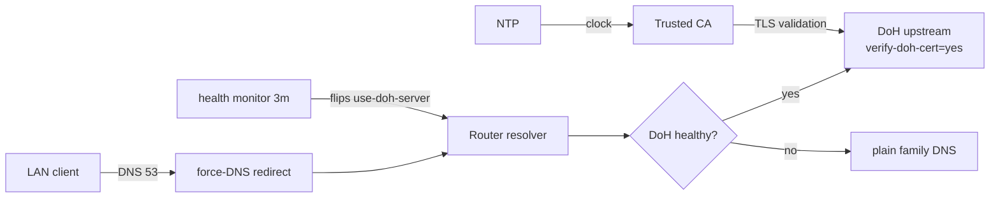

# mikrotik-doh-failover

<!-- md-i18n:switcher -->
**अन्य भाषाओं में:** [English](README.md) · [Deutsch](README.de.md) · [中文](README.zh.md) · हिन्दी · [Español](README.es.md) · [Русский](README.ru.md)

**MikroTik RouterOS के लिए फ़ेलओवर DNS-over-HTTPS (DoH) कॉन्फ़िगरेशन, diff करने योग्य `.rsc` स्क्रिप्ट के रूप में।**

[**दस्तावेज़**](docs/) · [**रिलीज़**](https://github.com/paulmann/mikrotik-doh-failover/releases) · [**चेंजलॉग**](CHANGELOG.md) · [**समस्याएँ**](https://github.com/paulmann/mikrotik-doh-failover/issues) · [**सुरक्षा**](SECURITY.md) · [**एजेंट के लिए**](AGENTS.md)

[](LICENSE)
[](https://github.com/paulmann/mikrotik-doh-failover/releases)
[](https://help.mikrotik.com/docs/spaces/ROS/pages/37748767/DNS)


RouterOS किसी LAN का DNS राउटर से होकर भेजता है, पर डिफ़ॉल्ट रूप से यह अपस्ट्रीम हिस्सा
सादे टेक्स्ट में जाता है। यह प्रोजेक्ट **एक सत्यापित** DoH अपस्ट्रीम सेट करता है और सादा
DNS को फ़ॉलबैक रखता है; LAN का पारंपरिक DNS राउटर की ओर बाध्य करता है; और एक निर्धारित
हेल्थ-चेक जोड़ता है जो विफलता पर DoH तथा सादा DNS के बीच बदलाव करता है। यह
`sysadministrator.ru` पर छपे लेख
[«Архитектура отказоустойчивого DNS-over-HTTPS в RouterOS»](https://sysadministrator.ru/%d0%b0%d1%80%d1%85%d0%b8%d1%82%d0%b5%d0%ba%d1%82%d1%83%d1%80%d0%b0-%d0%be%d1%82%d0%ba%d0%b0%d0%b7%d0%be%d1%83%d1%81%d1%82%d0%be%d0%b9%d1%87%d0%b8%d0%b2%d0%be%d0%b3%d0%be-dns-over-https-%d0%b2-routeros/)
का «इसे कैसे दोहराएँ और बनाए रखें» वाला साथी दस्तावेज़ है।

> **दस्तावेज़ की स्थिति।** इस README के आँकड़े 2026-10-22 (v0.1.0) को प्रकाशित ट्री से
> मापे गए हैं। डिज़ाइन का विस्तृत आधार [`docs/`](docs/) में है; स्क्रिप्ट RouterOS 7.23.1
> और 7.24.5 पर जाँची गई हैं।

---

> **0.2.0 (2026-10-26).** The default upstream is now the **standard** Cloudflare
> resolver (no filtering), the failover switches between two DoH endpoints instead
> of falling back to plain DNS, and the health check judges answers by content.
> Commands in this translation may predate that change — the canonical, current
> text is [README.md](README.md) and [docs/](docs/).

## विषय-सूची

- [यह क्या है और क्यों](#यह-क्या-है-और-क्यों)
- [क्षमताएँ](#क्षमताएँ)
- [आँकड़ों में](#आँकड़ों-में)
- [यह कैसे काम करता है](#यह-कैसे-काम-करता-है)
- [स्थापना](#स्थापना)
- [पहले कदम](#पहले-कदम)
- [विश्वसनीयता और सीमाएँ](#विश्वसनीयता-और-सीमाएँ)
- [सुरक्षा](#सुरक्षा)
- [आवश्यकताएँ और संगतता](#आवश्यकताएँ-और-संगतता)
- [दस्तावेज़](#दस्तावेज़)
- [योगदान](#योगदान)
- [लाइसेंस](#लाइसेंस)

---

## यह क्या है और क्यों

«MikroTik पर DoH» का एक आम पर टूटा हुआ तरीका यह है कि
`/ip dns static-server type=doh` से कई DoH सर्वर जोड़ दिए जाएँ और उनसे अनावश्यकता
(redundancy) की अपेक्षा की जाए। यह सिंटैक्स मौजूद ही नहीं है और अनावश्यकता देता भी नहीं;
RouterOS ठीक **एक** `use-doh-server` का समर्थन करता है। दूसरी आम ग़लती है भरोसेमंद CA के
बिना `verify-doh-cert=yes` लगाना — इससे नाम-विश्लेषण चुपचाप पूरी तरह रुक जाता है।

यह प्रोजेक्ट दोनों से बचता है:

- **एक सक्रिय DoH अपस्ट्रीम**, जिसमें सादे `servers` बूटस्ट्रैप और फ़ॉलबैक का काम करते हैं;
- **प्रबंधित फ़ेलओवर** स्क्रिप्ट, जो विफलता पर `use-doh-server` ख़ाली करती है और सुधार के
  बाद उसे फिर लगा देती है;
- **CA का स्पष्ट आयात** — जाँचा गया है कि 7.23/7.24 पर अंतर्निहित ट्रस्ट स्टोर Cloudflare
  की चेन को कवर नहीं करता;
- **बूटस्ट्रैप के लिए स्थिर A रिकॉर्ड**, ताकि सादा DNS बंद होने पर भी
  DoH होस्टनेम हल हो।

इस README और `docs/` का हर कथन असली डिवाइसों पर जाँचा गया है; जहाँ व्यवहार अलग है, वहाँ
संस्करण और `device-mode` लिखा गया है।

## क्षमताएँ

| क्षमता | विवरण |
|---|---|
| एन्क्रिप्टेड अपस्ट्रीम | `verify-doh-cert=yes` के साथ एक DoH अपस्ट्रीम |
| फ़ॉलबैक | DoH अगम्य होने पर सादा Family DNS (`1.1.1.3,1.0.0.3`) |
| सुधार | हेल्थ-चेक पास होने के बाद DoH पर स्वतः वापसी |
| बूटस्ट्रैप | DoH होस्टनेम के लिए स्थिर A रिकॉर्ड |
| पारंपरिक DNS बाध्य करना | LAN ब्रिज से आने वाले UDP/TCP 53 पर `dstnat redirect` |
| रिज़ॉल्वर की सुरक्षा | WAN से DNS छोड़ना, LAN से स्वीकार करना (UDP और TCP) |
| फ़ेलओवर नीति | केवल `read,write,policy,test` (`ftp`/`reboot`/`password` नहीं) |

## आँकड़ों में

2026-10-22 (v0.1.0) को प्रकाशित ट्री से मापा गया:

| क्षेत्र | संख्या | कहाँ से मापा |
|---|---|---|
| RouterOS स्क्रिप्ट | 7 | `routeros/` |
| उदाहरण कॉन्फ़िग | 1 | `examples/` |
| दस्तावेज़ | 3 | `docs/` |
| आरेख | 3 | `diagrams/` |
| परखे गए डिवाइस | 5 | `docs/verification.md` |
| परखे गए RouterOS संस्करण | 2 (7.23.1, 7.24.5) | `docs/verification.md` |

## यह कैसे काम करता है



| घटक | ज़िम्मेदारी |
|---|---|
| `00-install-ca.rsc` | `verify-doh-cert=yes` के लिए भरोसे का आधार |
| `01-configure-doh.rsc` | एक DoH अपस्ट्रीम + बूटस्ट्रैप + फ़ॉलबैक |
| `02-security-policies.rsc` | पारंपरिक DNS बाध्य करना + रिज़ॉल्वर की सुरक्षा |
| `03-capsman.rsc` | लक्षित CAPsMAN/DHCP एकीकरण |
| `04-cert-update.rsc` | वैकल्पिक CA नवीनीकरण |
| `05-dns-health-monitor.rsc` | हेल्थ-चेक + फ़ेलओवर शेड्यूलर |

## स्थापना

आवश्यकताएँ:

- RouterOS **7.20+** (7.23.1, 7.24.5 पर जाँचा गया);
- NTP समकालिक;
- स्वतः फ़ेलओवर **शेड्यूलर** के लिए `device-mode` `advanced`.

तेज़ शुरुआत (Cloudflare Family):

```rsc
# 1. Upload certs/cloudflare-doh-ca.crt to the router, then:
/import file-name=00-install-ca.rsc
/import file-name=01-configure-doh.rsc
/import file-name=02-security-policies.rsc
/import file-name=05-dns-health-monitor.rsc
```

अन्य प्रदाताओं (Quad9, Google, Cloudflare standard/security) के लिए
[`routeros/config.example.rsc`](routeros/config.example.rsc) में मान बदलें।

## पहले कदम

```rsc
/ip dns cache flush
:put [:resolve example.com]     # real IP
:put [:resolve pornhub.com]     # 0.0.0.0 with the Family filter
/log print where message~"connection error"
```

## विश्वसनीयता और सीमाएँ

| स्थिति | व्यवहार |
|---|---|
| DoH अगम्य | फ़ेलओवर स्क्रिप्ट सादे Family DNS पर चली जाती है (लॉग में `error`) |
| DoH सुधर गया | स्क्रिप्ट DoH फिर लगा देती है (लॉग में `warning`) |
| DoH और सादा DNS दोनों बंद | स्क्रिप्ट अंतिम कॉन्फ़िग रखती है और `critical` लिखती है |
| क्लाइंट अपना DoH/DoT इस्तेमाल करता है | **रोका नहीं जाता** (दस्तावेज़ित सीमा) |
| `device-mode=home` | शेड्यूलर अस्वीकार होता है; मॉनिटर हाथ से चलाएँ |

### शेड्यूलर अस्वीकृत: `not allowed by device-mode`

`device-mode=home` वाले डिवाइसों पर (जैसे यहाँ परखा गया RB4011iGS+) RouterOS
`/system scheduler add` और `/tool fetch` को `not allowed by device-mode` कहकर
अस्वीकार करता है। यह RouterOS की अपेक्षित सीमा है, स्क्रिप्ट का दोष नहीं: DoH कॉन्फ़िग
और DNS बाध्य करना काम करते रहते हैं, पर फ़ेलओवर मॉनिटर केवल हाथ से चलाया जा सकता है।
विकल्प:

1. `home` रहने दें और `/system script run DNS_HealthMonitor_Failover` हाथ से चलाएँ;
2. शेड्यूलर चालू करने के लिए `advanced` पर जाएँ:
   ```rsc
   /system/device-mode/update device-mode=advanced
   ```
   फिर बदलाव की पुष्टि करें और रीबूट करें।

## सुरक्षा

- रिज़ॉल्वर WAN से आने वाला DNS छोड़ देता है और केवल पारंपरिक DNS (53) को रीडायरेक्ट करता
  है; क्लाइंट का अपना DoH (443) या DoT (853) दस्तावेज़ में लिखा है, छिपाया नहीं गया।
- Cloudflare/Quad9/Google चुनने का अर्थ है अपनी क्वेरी उस तीसरे पक्ष को सौंपना; DoH उन्हें केवल
  स्थानीय लिंक से छिपाता है।
- CA का बूटस्ट्रैप भरोसेमंद स्रोत से; `check-certificate=no` केवल बूटस्ट्रैप के लिए।
- रिपोर्टिंग और सुरक्षा मॉडल: देखें [SECURITY.md](SECURITY.md).

## आवश्यकताएँ और संगतता

| डिवाइस | RouterOS | device-mode | वायरलेस स्टैक | परिणाम |
|---|---|---|---|---|
| Chateau PRO ax | 7.24.5 | advanced | पुराना `/caps-man` (कंट्रोलर) | जाँचा गया (हब) |
| cAP ax | 7.24.5 | advanced | पुराना `/caps-man` (क्लाइंट) | जाँचा गया |
| RB4011iGS+ | 7.24.5 | home | — | जाँचा गया; शेड्यूलर अवरुद्ध |
| hAP ax² | 7.24.5 | advanced | — | जाँचा गया |
| RB951Ui-2HnD | 7.24.5 | advanced | — | जाँचा गया |
| RB2011UiAS | 7.23.1 | advanced | — | जाँचा गया |

## दस्तावेज़

| दस्तावेज़ | विषय-वस्तु |
|---|---|
| [`docs/architecture.md`](docs/architecture.md) | डिज़ाइन का आधार और संकट मॉडल |
| [`docs/verification.md`](docs/verification.md) | प्रत्येक उपतंत्र की जाँच + फ़ेलओवर परीक्षण की सूची |
| [`docs/troubleshooting.md`](docs/troubleshooting.md) | ज्ञात विफलताएँ और उपाय |
| [`routeros/config.example.rsc`](routeros/config.example.rsc) | सभी बदले जा सकने वाले मान |

## योगदान

[CONTRIBUTING.md](CONTRIBUTING.md) पढ़ें। सुरक्षा संबंधी बातें: [SECURITY.md](SECURITY.md),
सार्वजनिक issue कभी नहीं।

## लाइसेंस

[MIT](LICENSE) © 2026 Mikhail Deynekin.
