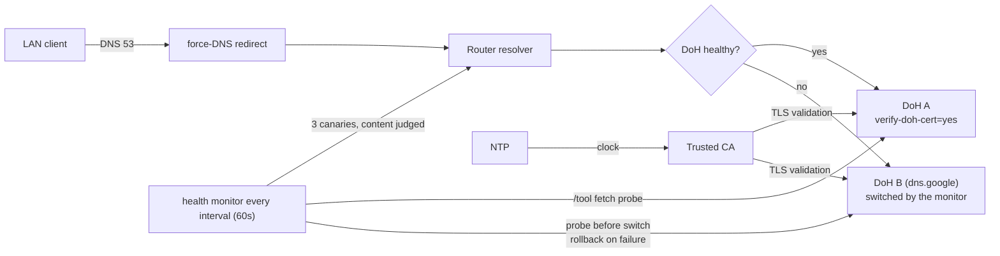

# mikrotik-doh-failover

<!-- md-i18n:switcher -->
**इसे पढ़ें:** [English](README.md) · [Deutsch](README.de.md) · [中文](README.zh.md) · हिन्दी · [Español](README.es.md) · [Русский](README.ru.md)

**MikroTik RouterOS के लिए failover DNS-over-HTTPS (DoH) कॉन्फ़िगरेशन, diff करने योग्य `.rsc` स्क्रिप्ट के रूप में।**

[**दस्तावेज़**](docs/) · [**रिलीज़**](https://github.com/paulmann/mikrotik-doh-failover/releases) · [**चेंजलॉग**](CHANGELOG.md) · [**Issues**](https://github.com/paulmann/mikrotik-doh-failover/issues) · [**सुरक्षा**](SECURITY.md) · [**एजेंट के लिए**](AGENTS.md)

[](LICENSE)
[](https://github.com/paulmann/mikrotik-doh-failover/releases)
[](https://help.mikrotik.com/docs/spaces/ROS/pages/37748767/DNS)


RouterOS किसी LAN का DNS राउटर से होकर भेजता है, लेकिन डिफ़ॉल्ट रूप से वह
upstream हिस्सा plaintext होता है। यह प्रोजेक्ट एक **सत्यापित** DoH upstream
कॉन्फ़िगर करता है और failover के रूप में दूसरा सत्यापित DoH endpoint रखता है,
LAN के पुराने (classic) DNS को राउटर की ओर बाध्य करता है, और एक अनुसूचित
health-check जोड़ता है जो विफलता पर endpoint बदल देता है। यह लेख
[«Архитектура отказоустойчивого DNS-over-HTTPS в RouterOS»](https://sysadministrator.ru/%d0%b0%d1%80%d1%85%d0%b8%d1%82%d0%b5%d0%ba%d1%82%d1%83%d1%80%d0%b0-%d0%be%d1%82%d0%ba%d0%b0%d0%b7%d0%be%d1%83%d1%81%d1%82%d0%be%d0%b9%d1%87%d0%b8%d0%b2%d0%be%d0%b3%d0%be-dns-over-https-%d0%b2-routeros/)
का «कैसे दोहराएँ और कैसे बनाए रखें» साथी दस्तावेज़ है, जो `sysadministrator.ru`
पर है।

> **दस्तावेज़ की स्थिति।** कवर किया गया संस्करण: **0.4.0** (`main`, नवीनतम tag `v0.3.1`),
> 2026-10-26)। «संख्याओं में» में दी गई संख्याएँ `main` पर 0.2.0 के दस्तावेज़
> दौर के बाद,
> 2026-10-26 को `git ls-files` और `Get-ChildItem` से मापी गई हैं। व्यवहार
> RouterOS 7.23.1 और 7.24.5 पर सत्यापित किया गया; जो कुछ किसी डिवाइस पर
> सत्यापित नहीं है, उसे पाठ में वैसा ही चिह्नित किया गया है, और `device-mode`
> का उल्लेख हर वहाँ किया गया है जहाँ वह परिणाम बदलता है।

---

## विषय-सूची

- [यह क्या है और क्यों](#यह-क्या-है-और-क्यों)
- [0.2.0 में क्या बदला](#020-में-क्या-बदला)
- [क्षमताएँ](#क्षमताएँ)
- [संख्याओं में](#संख्याओं-में)
- [यह कैसे काम करता है](#यह-कैसे-काम-करता-है)
- [इंस्टॉलेशन](#इंस्टॉलेशन)
- [पहले कदम](#पहले-कदम)
- [विश्वसनीयता और सीमाएँ](#विश्वसनीयता-और-सीमाएँ)
- [सुरक्षा](#सुरक्षा)
- [आवश्यकताएँ और अनुकूलता](#आवश्यकताएँ-और-अनुकूलता)
- [दस्तावेज़](#दस्तावेज़)
- [योगदान](#योगदान)
- [लाइसेंस](#लाइसेंस)

---

## यह क्या है और क्यों

«MikroTik पर DoH» का एक आम गलत तरीका यह है कि `/ip dns static-server type=doh`
से कई DoH सर्वर जोड़ दिए जाएँ और failover की अपेक्षा की जाए। ऐसा syntax मौजूद
ही नहीं है और redundancy नहीं बनाता; RouterOS ठीक **एक** `use-doh-server` का
समर्थन करता है। दूसरी आम विफलता भरोसेमंद CA के बिना `verify-doh-cert=yes`
लगाना है, जो चुपचाप पूरा resolution रोक देता है।

यह प्रोजेक्ट दोनों से बचता है:

- **एक सक्रिय DoH upstream** — डिफ़ॉल्ट रूप से मानक Cloudflare, बिना filtering;
  plain `servers` केवल bootstrap हैं और कभी काम करने वाले fallback के रूप में
  उपयोग नहीं होते;
- **प्रबंधित failover** स्क्रिप्ट, जो विफलता पर दूसरे DoH endpoint पर जाती है,
  स्विच को सत्यापित करती है और रिकवरी के बाद प्राथमिक पर लौटती है;
- **स्पष्ट CA import** — सत्यापित किया गया कि 7.23/7.24 पर built-in trust store
  Cloudflare chain को कवर नहीं करता;
- **दोनों endpoint hosts के लिए bootstrap static A records**, ताकि health probe
  उन तक तब भी पहुँच सके जब resolver खुद मृत हो।

## 0.4.0 में क्या बदला

- endpoint probe मेमोरी में चलता है: `/tool fetch ... as-value output=user`, `/file` में कोई अस्थायी फ़ाइल नहीं और कोई cleanup race नहीं। JSON जाँच `"Status":0` और `"Status": 0` दोनों स्वीकार करती है।
- failover एक क्रमबद्ध chain है: primary → secondary → tertiary (`dohUrlC`, वैकल्पिक) → plain DNS (`plainFallback`, डिफ़ॉल्ट रूप से बंद)।
- नई स्थिति `plain` (अंतिम plain DNS विकल्प), लॉग `PRIVACY DEGRADED`, और primary पर वापसी।

## 0.2.0 में क्या बदला

संस्करण 0.1.0 में एक ऐसी गलती थी जो फ़ील्ड में मायने रखती थी: वह resolver को
स्वस्थ तब बताता था जब उत्तर `8.6.112.0` / `8.47.69.0` की जोड़ी होती थी, जहाँ
कई नेटवर्क पहुँच नहीं पाते — पेज खुलना बंद हो गए, जबकि monitor «ठीक है» बता
रहा था। 0.2.0 में पाँच बातें बदलती हैं (पूरा पाठ:
[`docs/release-notes-v0.2.0.md`](docs/release-notes-v0.2.0.md)):

| बदलाव | पहले (0.1.0) | अब (0.2.0) |
|---|---|---|
| डिफ़ॉल्ट upstream | Cloudflare Family (`family.cloudflare-dns.com`, filtering) | Cloudflare **standard** (`cloudflare-dns.com`, 1.1.1.1/1.0.0.1), filtering अब opt-in है |
| Failover लक्ष्य | plain DNS fallback | दूसरा **DoH** endpoint (`dns.google`) |
| Health check | कोई भी वैध IP स्वस्थ गिना जाता था | उत्तर का **content** तीन canaries से परखा जाता है |
| Endpoint probe | `use-doh-server` बदला जाता था (हर जाँच पर LAN का DoH टूटता था) | DNS-JSON API पर `/tool fetch`, `/ip dns` अछूता |
| असफल failover | राउटर मृत endpoint पर छूट जाता था | पहले probe, बाद में सत्यापन, विफलता पर rollback |

0.1.0 से upgrade करने पर स्क्रिप्ट कॉपी करने के अलावा दो कदम चाहिए: पुराने state
globals (`DNSMonitorState`, `DNSFailoverAttempts`) साफ़ करें, और स्पष्ट रूप से
तय करें कि filtering वापस चाहिए या नहीं — इसके लिए Family का URL, उसके अनुरूप
`servers` और `examples/cloudflare-family.rsc` का CA चाहिए।
`05-dns-health-monitor.rsc` में `filtering` केवल पाठक के लिए संकेत है: स्क्रिप्ट
इसे घोषित करती है और कभी पढ़ती नहीं, इसलिए न व्यवहार न लॉग पंक्ति इस पर निर्भर
है (26.10.2026 को मापा गया)। 0.1.0 का global
`DNSCurrentMode` अब मौजूद नहीं है।

## क्षमताएँ

| क्षमता | विवरण |
|---|---|
| Encrypted upstream | `verify-doh-cert=yes` के साथ एक DoH upstream |
| Fallback | प्राथमिक अनुपलब्ध होने पर दूसरा **DoH** endpoint (Google) |
| Recovery | health check पास होने के बाद प्राथमिक पर स्वतः वापसी |
| Health check | प्रकार नहीं, ANSWER (content) परखता है; endpoints को `/tool fetch` से probe करता है |
| Bootstrap | दोनों endpoint hostnames के लिए static A records |
| Classic DNS बाध्य करना | LAN bridge से UDP/TCP 53 का `dstnat redirect` |
| Resolver सुरक्षा | WAN से DNS drop, LAN से accept (UDP और TCP) |
| Failover नीति | केवल `read,write,policy,test` (`ftp`/`reboot`/`password` नहीं) |
| Fleet monitoring | SSH पर DoH और VPN स्थिति के लिए Zabbix 8 collector — `zabbix/`, `v0.2.0` tag के बाद `main` पर |

## संख्याओं में

`main` पर, 2026-10-26 को मापा गया:

| क्षेत्र | संख्या | कहाँ से मापा |
|---|---|---|
| RouterOS स्क्रिप्ट | 7 (360 पंक्तियाँ) | `routeros/*.rsc` |
| उदाहरण कॉन्फ़िग | 2 | `examples/*.rsc` |
| दस्तावेज़ | 5 | `docs/*.md` |
| आरेख | 3 | `diagrams/*.mmd` |
| README भाषाएँ | 6 | `README*.md` |
| git द्वारा ट्रैक फ़ाइलें | 38 | `git ls-files` |
| परीक्षित डिवाइस | 6 | `docs/verification.md`, नीचे तालिका |
| परीक्षित RouterOS संस्करण | 2 (7.23.1, 7.24.5) | `docs/verification.md` |
| Zabbix ऑब्जेक्ट | 8 items, 5 triggers, 2 service trees | `zabbix/doh-zabbix-setup.py` |

`v0.2.0` tag में स्वयं 32 फ़ाइलें हैं; `zabbix/` की सारी सामग्री tag के बाद
commit हुई, इसलिए अगले संस्करण तक वह `main` पर unreleased है।

## यह कैसे काम करता है



Monitor endpoint जाँचने के लिए कभी `use-doh-server` नहीं बदलता: probe `/tool fetch`
से भेजा गया HTTPS अनुरोध है, इसलिए नियमित जाँच `/ip dns` को अछूता छोड़ देती है।
State machine (आरेख: [`diagrams/dns-failover.mmd`](diagrams/dns-failover.mmd))
है `healthy` → `suspect` → `fallback` → `recovering` → `healthy`; साथ ही `stub`, `plain`, `degraded`, `clock-invalid`, `manual-only` (किनारे की स्थितियाँ); लॉग केवल संक्रमणों पर।

| घटक | ज़िम्मेदारी |
|---|---|
| `00-install-ca.rsc` | `verify-doh-cert=yes` के लिए trust anchor |
| `01-configure-doh.rsc` | एक DoH upstream + दोनों endpoint hosts के लिए bootstrap |
| `02-security-policies.rsc` | classic DNS बाध्य करना + resolver सुरक्षा |
| `03-capsman.rsc` | लक्षित CAPsMAN/DHCP एकीकरण |
| `04-cert-update.rsc` | वैकल्पिक CA refresh |
| `05-dns-health-monitor.rsc` | content जाँच + DoH-to-DoH failover (`maxAttempts=3`) |

## इंस्टॉलेशन

आवश्यकताएँ:

- RouterOS **7.20+** जैसा घोषित है; व्यवहार केवल **7.23.1** और **7.24.5** पर
  सत्यापित;
- NTP synchronized;
- स्वचालित failover **scheduler** के लिए `device-mode` `advanced`।

Quick start (मानक Cloudflare, बिना filtering — 0.2.0 से डिफ़ॉल्ट):

```rsc
# 1. Upload certs/cloudflare-doh-ca.crt to the router, then:
/import file-name=00-install-ca.rsc
/import file-name=01-configure-doh.rsc
/import file-name=02-security-policies.rsc
/import file-name=05-dns-health-monitor.rsc
```

अन्य प्रदाताओं (Quad9, Google, Cloudflare standard/security) के लिए
[`routeros/config.example.rsc`](routeros/config.example.rsc) में मान बदलें। raw
URLs को `v0.2.0` (या किसी commit) पर pin करना `main` से सुरक्षित है; `main` tag
से आगे है।

## पहले कदम

```rsc
/ip dns cache flush
:put [:resolve example.com]     # expect 104.20.x / 172.66.x
                                # 8.6.112.0 / 8.47.69.0 is the "stub pair", not an outage:
                                # see docs/troubleshooting.md §6.10
:put [:resolve pornhub.com]     # a real IP with the standard resolver;
                                # 0.0.0.0 only with Family/Security
/log print where message~"connection error"
```

## विश्वसनीयता और सीमाएँ

| स्थिति | व्यवहार |
|---|---|
| DoH अनुपलब्ध | monitor fallback DoH पर जाता है, उसे सत्यापित करता है, विफल होने पर rollback करता है (लॉग `error`/`warning`) |
| DoH ठीक हो जाता है | monitor प्राथमिक पर लौटता है (लॉग `warning`) |
| दोनों endpoints डाउन | monitor मौजूदा कॉन्फ़िगरेशन रखता है और एक बार `error` लिखता है |
| उत्तर stub pair हैं | monitor इसे एक बार लॉग करता है और failover **नहीं** करता — दूसरा endpoint वही जोड़ी लौटाता है (§6.10) |
| घड़ी गलत है | monitor `clock looks wrong …` लिखकर रुक जाता है, क्योंकि गलत तारीख़ पर certificate validation सफल नहीं हो सकती |
| Failover बार-बार विफल | प्रति outage अधिकतम 3 प्रयास, फिर monitor लॉग भरने के बजाय प्राथमिक के ठीक होने की प्रतीक्षा करता है |
| Client अपना DoH/DoT उपयोग करता है | **अवरुद्ध नहीं** (प्रलेखित सीमा) |
| `device-mode=home` | `fetch` और scheduler अस्वीकृत; monitor हाथ से चलाएँ |

### Scheduler अस्वीकृत: `not allowed by device-mode`

`device-mode=home` वाले डिवाइस पर (उदाहरण के लिए यहाँ परीक्षित RB4011iGS+),
RouterOS `/system scheduler add` और `/tool fetch` को `not allowed by
device-mode` के साथ अस्वीकार करता है। यह RouterOS की अपेक्षित सीमा है, स्क्रिप्ट
का दोष नहीं: DoH कॉन्फ़िग और force-DNS तब भी काम करते हैं, लेकिन failover
monitor केवल हाथ से चलाया जा सकता है, और `fetch` के बिना वह endpoints को probe
ही नहीं कर सकता — तब वह मौजूदा कॉन्फ़िगरेशन बनाए रखता है।

1. `home` छोड़ें और `/system script run DNS_HealthMonitor_Failover` हाथ से चलाएँ;
2. scheduler सक्षम करने के लिए `advanced` पर जाएँ:
   ```rsc
   /system/device-mode/update device-mode=advanced
   ```
   फिर बदलाव की पुष्टि करें और reboot करें।

## सुरक्षा

- Resolver WAN से DNS drop करता है और केवल classic DNS (53) redirect करता है;
  client का DoH (443) और DoT (853) bypass प्रलेखित है, छिपाया नहीं गया।
- Cloudflare/Quad9/Google चुनने का अर्थ है अपनी queries के लिए उस तीसरे पक्ष पर
  भरोसा करना; DoH उन्हें केवल स्थानीय link से छिपाता है।
- CA bootstrap भरोसेमंद स्रोत से होना चाहिए; `check-certificate=no` केवल
  bootstrap के लिए है।
- Failover लक्ष्य ऐसा DoH endpoint होना चाहिए जो DNS-JSON API का उत्तर दे — Quad9
  fallback हमेशा अनुपलब्ध दिखेगा (`docs/troubleshooting.md` §6.12)।
- रिपोर्टिंग और security model के लिए [SECURITY.md](SECURITY.md) देखें।

## आवश्यकताएँ और अनुकूलता

| डिवाइस | RouterOS | device-mode | Wireless stack | परिणाम |
|---|---|---|---|---|
| Chateau PRO ax | 7.24.5 | advanced | legacy `/caps-man` (controller) | सत्यापित (hub) |
| cAP ax | 7.24.5 | advanced | legacy `/caps-man` (client) | सत्यापित |
| RB4011iGS+ | 7.24.5 | home | — | सत्यापित; scheduler अवरुद्ध |
| hAP ax² | 7.24.5 | advanced | — | सत्यापित |
| RB951Ui-2HnD | 7.24.5 | advanced | — | सत्यापित |
| RB2011UiAS | 7.23.1 | advanced | — | सत्यापित |

## दस्तावेज़

| दस्तावेज़ | विषय-वस्तु |
|---|---|
| [`docs/architecture.md`](docs/architecture.md) | डिज़ाइन का तर्क, state तालिका, threat model |
| [`docs/verification.md`](docs/verification.md) | प्रति-सबसिस्टम जाँच + आठ failover परिदृश्य |
| [`docs/troubleshooting.md`](docs/troubleshooting.md) | ज्ञात विफलताएँ और workarounds, §6.10 (stub pair) सहित |
| [`docs/release-notes-v0.2.0.md`](docs/release-notes-v0.2.0.md) | 0.2.0 ने क्या बदला और उसके पीछे के माप |
| [`zabbix/README.md`](zabbix/README.md) | Zabbix में fleet monitoring: DoH और VPN स्थिति, triggers, service tree |
| [`routeros/config.example.rsc`](routeros/config.example.rsc) | सभी tunable मान |
| [`AGENTS.md`](AGENTS.md) | वही अनुबंध, मशीन caller के लिए लिखा गया |

## योगदान

[CONTRIBUTING.md](CONTRIBUTING.md) पढ़ें। सुरक्षा मुद्दे: [SECURITY.md](SECURITY.md),
कभी public issue नहीं।

## लाइसेंस

[MIT](LICENSE) © 2026 Mikhail Deynekin.
