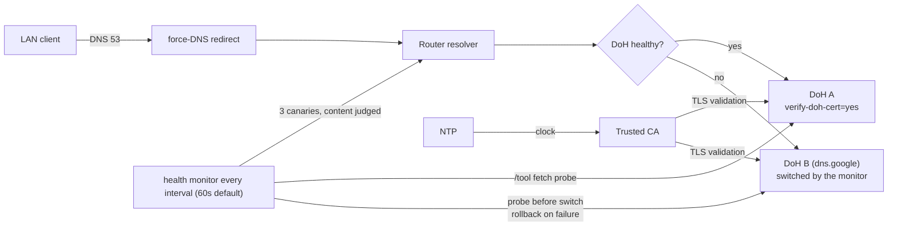

# mikrotik-doh-failover

<!-- md-i18n:switcher -->
**Read this in:** English · [Deutsch](README.de.md) · [中文](README.zh.md) · [हिन्दी](README.hi.md) · [Español](README.es.md) · [Русский](README.ru.md)

**Failover DNS-over-HTTPS (DoH) configuration for MikroTik RouterOS, as diffable `.rsc` scripts.**

[**Docs**](docs/) · [**Releases**](https://github.com/paulmann/mikrotik-doh-failover/releases) · [**Changelog**](CHANGELOG.md) · [**Issues**](https://github.com/paulmann/mikrotik-doh-failover/issues) · [**Security**](SECURITY.md) · [**For agents**](AGENTS.md)

[](LICENSE)
[](https://github.com/paulmann/mikrotik-doh-failover/releases)
[](https://help.mikrotik.com/docs/spaces/ROS/pages/37748767/DNS)


RouterOS routes a LAN's DNS through the router, but by default that upstream leg
is plaintext. This project configures one **verified** DoH upstream with a
second verified DoH endpoint as failover, forces classic LAN DNS to the router,
and adds a scheduled health-check that switches endpoints on failure. It is the
"how to reproduce and maintain" companion to the article
[«Архитектура отказоустойчивого DNS-over-HTTPS в RouterOS»](https://sysadministrator.ru/%d0%b0%d1%80%d1%85%d0%b8%d1%82%d0%b5%d0%ba%d1%82%d1%83%d1%80%d0%b0-%d0%be%d1%82%d0%ba%d0%b0%d0%b7%d0%be%d1%83%d1%81%d1%82%d0%be%d0%b9%d1%87%d0%b8%d0%b2%d0%be%d0%b3%d0%be-dns-over-https-%d0%b2-routeros/)
on `sysadministrator.ru`.

> **Documentation status.** Version **v0.4.1** (tagged 2026-10-28). Counts in
> "By the numbers" were re-measured on 2026-10-28. Behaviour was verified on
> RouterOS 7.23.1 and 7.24.5; anything not verified on a device is marked as such
> in the text, and `device-mode` is named wherever it changes the outcome.

---

## Contents

- [What this is and why](#what-this-is-and-why)
- [What changed in 0.2.0](#what-changed-in-020)
- [Capabilities](#capabilities)
- [By the numbers](#by-the-numbers)
- [How it works](#how-it-works)
- [Installation](#installation)
- [First steps](#first-steps)
- [Reliability and limits](#reliability-and-limits)
- [Security](#security)
- [Requirements and compatibility](#requirements-and-compatibility)
- [Documentation](#documentation)
- [Contributing](#contributing)
- [License](#license)

---

## What this is and why

A common broken approach to "DoH on MikroTik" is to add several DoH servers via
`/ip dns static-server type=doh` and expect failover. That syntax does not exist
and does not produce redundancy; RouterOS supports exactly **one** `use-doh-server`.
Another common failure is `verify-doh-cert=yes` without a trusted CA, which
silently stops all resolution.

This project avoids both:

- **one active DoH upstream** — standard Cloudflare by default, no filtering;
  plain `servers` are bootstrap only and are never used as a working fallback;
- **a managed failover** script that switches to a second DoH endpoint on
  failure, verifies the switch and returns to the primary after recovery;
- **an explicit CA import** — verified that the built-in trust store does not
  cover the Cloudflare chain on 7.23/7.24;
- **bootstrap static A records for both endpoint hosts**, so the health probe
  can reach them even when the resolver itself is dead.

## What changed in 0.2.0

Version 0.1.0 was wrong in a way that mattered in the field: it called the
resolver healthy when the answer was the pair `8.6.112.0` / `8.47.69.0`, which
several networks cannot reach — pages stopped opening while the monitor reported
"fine". 0.2.0 changes five things (full text:
[`docs/release-notes-v0.2.0.md`](docs/release-notes-v0.2.0.md)):

| Change | Before (0.1.0) | Now (0.2.0) |
|---|---|---|
| Default upstream | Cloudflare Family (`family.cloudflare-dns.com`, filtering) | Cloudflare **standard** (`cloudflare-dns.com`, 1.1.1.1/1.0.0.1); filtering is an opt-in |
| Failover target | plain DNS fallback | a second **DoH** endpoint (`dns.google`) |
| Health check | any valid IP counted as healthy | answer **content** judged via three canaries |
| Endpoint probe | flipped `use-doh-server` (LAN lost DoH on every check) | `/tool fetch` against the DNS-JSON API, `/ip dns` untouched |
| Failed failover | router left on a dead endpoint | probed before, verified after, rolled back on failure |

Upgrading from 0.1.0 needs two steps beyond copying the scripts: clear the old
state globals (`DNSMonitorState`, `DNSFailoverAttempts`), and decide explicitly
whether you want filtering back — that means the Family URL, the matching
`servers` and the CA from `examples/cloudflare-family.rsc`. The `filtering` flag
in `05-dns-health-monitor.rsc` is a marker for the reader only: the script
declares it and never reads it, so nothing in the log depends on it (measured
2026-10-26). The 0.1.0 global `DNSCurrentMode` no longer exists.

## Capabilities

| Capability | Detail |
|---|---|
| Encrypted upstream | one DoH upstream with `verify-doh-cert=yes` |
| Fallback | a second **DoH** endpoint (Google) when the primary is unreachable — managed, not transparent: the operator changes |
| Recovery | automatic return to the primary after the health check passes |
| Health check | judges the ANSWER (content), not the type; probes endpoints with `/tool fetch` |
| Bootstrap | static A records for both endpoint hostnames |
| Force classic DNS | `dstnat redirect` of UDP/TCP 53 from the LAN bridge |
| Resolver protection | drop DNS from WAN, accept from LAN (UDP and TCP) |
| Failover policy | `read,write,policy,test` only (no `ftp`/`reboot`/`password`) |
| Fleet monitoring | Zabbix 8 collector for DoH and VPN state over SSH — `zabbix/`, on `main` after the `v0.2.0` tag |

## By the numbers

Measured on `main`, 2026-10-26:

| Surface | Count | Measured from |
|---|---|---|
| RouterOS scripts | 7 (360 lines) | `routeros/*.rsc` |
| Example configs | 2 | `examples/*.rsc` |
| Docs | 5 | `docs/*.md` |
| Diagrams | 3 | `diagrams/*.mmd` |
| README languages | 6 | `README*.md` |
| Files tracked by git | 38 | `git ls-files` |
| Devices tested | 6 | `docs/verification.md`, table below |
| RouterOS versions tested | 2 (7.23.1, 7.24.5) | `docs/verification.md` |
| Zabbix objects | 8 items, 5 triggers, 2 service trees | `zabbix/doh-zabbix-setup.py` |

The `v0.2.0` tag itself contains 32 files; everything under `zabbix/` was
committed after the tag and is therefore unreleased on `main` until the next
version.

## How it works



The monitor never toggles `use-doh-server` to test an endpoint: the probe is an
HTTPS request from `/tool fetch`, so a routine check leaves `/ip dns` alone. The
state machine (diagram: [`diagrams/dns-failover.mmd`](diagrams/dns-failover.mmd),
full definition in [`docs/architecture.md`](docs/architecture.md)) is
`healthy` → `suspect` → `fallback` → `recovering` → `healthy`, with `stub`,
`plain`, `degraded`, `clock-invalid` and `manual-only` as terminal/edge states.
Failover is **managed**, not transparent: the upstream operator changes, so
answers, filtering and geo behaviour may change too.

**What changed in 0.4.0.** The endpoint probe now returns the JSON body in memory
(`/tool fetch ... as-value output=user`), so it creates no temporary files in
`/file` and cannot leave stale ones behind; the JSON check accepts both
`"Status":0` and `"Status": 0`. Failover is an ordered chain: primary → secondary →
tertiary (`dohUrlC`, optional, empty disables it) → plain DNS (`plainFallback`,
optional, off by default and logged `PRIVACY DEGRADED`).

| Component | Responsibility |
|---|---|
| `00-install-ca.rsc` | trust anchor for `verify-doh-cert=yes` |
| `01-configure-doh.rsc` | one DoH upstream + bootstrap for both endpoint hosts |
| `02-security-policies.rsc` | force classic DNS + resolver protection |
| `03-capsman.rsc` | targeted CAPsMAN/DHCP integration |
| `04-cert-update.rsc` | optional CA refresh |
| `05-dns-health-monitor.rsc` | content check + DoH-to-DoH failover (`maxAttempts=3`) |

## Installation

Requirements:

- RouterOS **7.20+** as declared; behaviour verified only on **7.23.1** and
  **7.24.5**;
- NTP synchronized;
- `device-mode` `advanced` for the automatic failover **scheduler**.

> **`device-mode=home`.** On `home` devices the failover scheduler and
> `/tool fetch` are rejected (`not allowed by device-mode`): DoH and force-DNS
> still work, but the monitor runs manually and cannot fail over — it logs
> `MONITOR_DISABLED_BY_DEVICE_MODE` and enters `manual-only`. Switch to
> `advanced` (`/system/device-mode/update device-mode=advanced`, then confirm and
> reboot) for automatic failover.

Quick start (standard Cloudflare, no filtering — the default since 0.2.0):

```rsc
# 1. Upload certs/cloudflare-doh-ca.crt to the router, then:
/import file-name=00-install-ca.rsc
/import file-name=01-configure-doh.rsc
/import file-name=02-security-policies.rsc
/import file-name=05-dns-health-monitor.rsc
```

For other providers (Quad9, Google, Cloudflare standard/security) edit the
values in [`routeros/config.example.rsc`](routeros/config.example.rsc). Pinning
raw URLs to `v0.2.0` (or a commit) is safer than `main`; `main` is ahead of the tag.

## First steps

```rsc
/ip dns cache flush
:put [:resolve example.com]     # expect 104.20.x / 172.66.x
                                # 8.6.112.0 / 8.47.69.0 is the "stub pair", not an outage:
                                # see docs/troubleshooting.md §6.10
:put [:resolve pornhub.com]     # a real IP with the standard resolver;
                                # 0.0.0.0 only with Family/Security
/log print where message~"connection error"
```

## Reliability and limits

| Situation | Behaviour |
|---|---|
| Primary DoH unreachable | after `failureThreshold` bad runs the monitor switches to the fallback, verifies it, rolls back if it fails |
| Primary DoH recovers | after `recoveryThreshold` good runs the monitor returns to the primary |
| Both endpoints down | state `degraded`: keeps the current configuration, logs once |
| Answers are the stub pair | state `stub`: logs once, does **not** fail over (§6.10) |
| Clock is wrong | state `clock-invalid`: logs `CLOCK_INVALID` and stops — `verify-doh-cert` cannot succeed on a wrong date |
| Failover keeps failing | at most `maxAttempts` (3) per outage, then the monitor waits for the primary |
| `device-mode=home` | state `manual-only`: logs `MONITOR_DISABLED_BY_DEVICE_MODE`; run by hand, no failover |
| Client uses its own DoH/DoT | not blocked in `standard`; `strict` blocks DoT 853 and known public DoH endpoints (residual risk documented) |

### Scheduler rejected: `not allowed by device-mode`

On devices with `device-mode=home` (for example the RB4011iGS+ tested here),
RouterOS rejects `/system scheduler add` and `/tool fetch` with
`not allowed by device-mode`. This is an expected RouterOS limit, not a script
defect: the DoH config and force-DNS still work, but the failover monitor can
only be run manually, and without `fetch` it cannot probe endpoints at all — it
then keeps the current configuration.

1. leave `home` and run `/system script run DNS_HealthMonitor_Failover` by hand;
2. switch to `advanced` to enable the scheduler:
   ```rsc
   /system/device-mode/update device-mode=advanced
   ```
   then confirm the change and reboot.

## Security

- The resolver drops DNS from WAN and only redirects classic DNS (53); client
  DoH (443) and DoT (853) bypass is documented, not hidden.
- Choosing Cloudflare/Quad9/Google means trusting that third party with your
  queries; DoH hides them from the local link only.
- CA bootstrap must use a trusted source; `check-certificate=no` is bootstrap-only.
- The failover target must be a DoH endpoint that answers the DNS-JSON API — a
  Quad9 fallback would always look unreachable (`docs/troubleshooting.md` §6.12).
- See [SECURITY.md](SECURITY.md) for reporting and the security model.

## Requirements and compatibility

| Device | RouterOS | device-mode | Wireless stack | Result |
|---|---|---|---|---|
| Chateau PRO ax | 7.24.5 | advanced | legacy `/caps-man` (controller) | verified (hub) |
| cAP ax | 7.24.5 | advanced | legacy `/caps-man` (client) | verified |
| RB4011iGS+ | 7.24.5 | home | — | verified; scheduler blocked |
| hAP ax² | 7.24.5 | advanced | — | verified |
| RB951Ui-2HnD | 7.24.5 | advanced | — | verified |
| RB2011UiAS | 7.23.1 | advanced | — | verified |

## Documentation

| Document | Contents |
|---|---|
| [`docs/architecture.md`](docs/architecture.md) | design rationale, state table, threat model |
| [`docs/verification.md`](docs/verification.md) | per-subsystem checks + eight failover scenarios |
| [`docs/troubleshooting.md`](docs/troubleshooting.md) | known failures and workarounds, including §6.10 (stub pair) |
| [`docs/release-notes-v0.2.0.md`](docs/release-notes-v0.2.0.md) | what 0.2.0 changed and the measurements behind it |
| [`zabbix/README.md`](zabbix/README.md) | fleet monitoring in Zabbix: DoH and VPN state, triggers, service tree |
| [`routeros/config.example.rsc`](routeros/config.example.rsc) | all tunable values |
| [`AGENTS.md`](AGENTS.md) | the same contract written for a machine caller |

## Contributing

Read [CONTRIBUTING.md](CONTRIBUTING.md). Security issues: [SECURITY.md](SECURITY.md),
never a public issue.

## License

[MIT](LICENSE) © 2026 Mikhail Deynekin.
