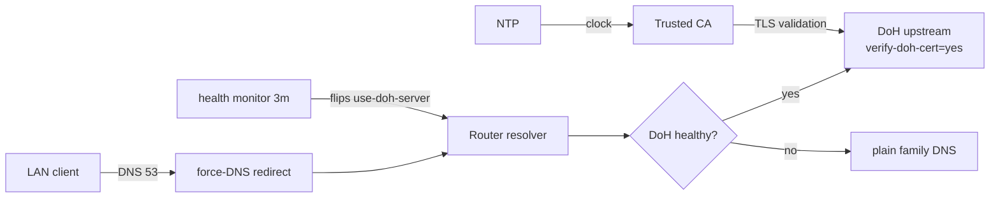

# mikrotik-doh-failover

**Failover DNS-over-HTTPS (DoH) configuration for MikroTik RouterOS, as diffable `.rsc` scripts.**

[**Docs**](docs/) · [**Releases**](https://github.com/paulmann/mikrotik-doh-failover/releases) · [**Changelog**](CHANGELOG.md) · [**Issues**](https://github.com/paulmann/mikrotik-doh-failover/issues) · [**Security**](SECURITY.md)

[](LICENSE)
[](https://github.com/paulmann/mikrotik-doh-failover/releases)
[](https://help.mikrotik.com/docs/spaces/ROS/pages/37748767/DNS)

RouterOS routes a LAN's DNS through the router, but by default that upstream leg
is plaintext. This project configures one **verified** DoH upstream with a
plain-DNS fallback, forces classic LAN DNS to the router, and adds a scheduled
health-check that switches between DoH and plain DNS on failure. It is the
"how to reproduce and maintain" companion to the article
[«Архитектура отказоустойчивого DNS-over-HTTPS в RouterOS»](https://sysadministrator.ru/%d0%b0%d1%80%d1%85%d0%b8%d1%82%d0%b5%d0%ba%d1%82%d1%83%d1%80%d0%b0-%d0%be%d1%82%d0%ba%d0%b0%d0%b7%d0%be%d1%83%d1%81%d1%82%d0%be%d0%b9%d1%87%d0%b8%d0%b2%d0%be%d0%b3%d0%be-dns-over-https-%d0%b2-routeros/)
on `sysadministrator.ru`.

> **Documentation status.** Counts in this README were measured from the
> published tree on 2026-10-22 (v0.1.0). Long-form design rationale is in
> [`docs/`](docs/); the scripts were verified on RouterOS 7.23.1 and 7.24.5.

---

## Contents

- [What this is and why](#what-this-is-and-why)
- [Capabilities](#capabilities)
- [By the numbers](#by-the-numbers)
- [How it works](#how-it-works)
- [Installation](#installation)
- [First steps](#first-steps)
- [Reliability and limits](#reliability-and-limits)
- [Security](#security)
- [Requirements and compatibility](#requirements-and-compatibility)
- [Documentation](#documentation)
- [Contributing](#contributing)
- [License](#license)

---

## What this is and why

A common broken approach to "DoH on MikroTik" is to add several DoH servers via
`/ip dns static-server type=doh` and expect failover. That syntax does not exist
and does not produce redundancy; RouterOS supports exactly **one** `use-doh-server`.
Another common failure is `verify-doh-cert=yes` without a trusted CA, which
silently stops all resolution.

This project avoids both:

- **one active DoH upstream**, with plain `servers` as bootstrap and fallback;
- **a managed failover** script that clears `use-doh-server` on failure and
  restores it after recovery;
- **an explicit CA import** — verified that the built-in trust store does not
  cover the Cloudflare chain on 7.23/7.24;
- **bootstrap static A records** so the DoH hostname resolves even if plain DNS
  is down.

Every claim in this README and in `docs/` was verified on real devices; the
version and `device-mode` are stated where behaviour differs.

## Capabilities

| Capability | Detail |
|---|---|
| Encrypted upstream | one DoH upstream with `verify-doh-cert=yes` |
| Fallback | plain family DNS (`1.1.1.3,1.0.0.3`) when DoH is unreachable |
| Recovery | automatic return to DoH after the health check passes |
| Bootstrap | static A records for the DoH hostname |
| Force classic DNS | `dstnat redirect` of UDP/TCP 53 from the LAN bridge |
| Resolver protection | drop DNS from WAN, accept from LAN (UDP and TCP) |
| Failover policy | `read,write,policy,test` only (no `ftp`/`reboot`/`password`) |

## By the numbers

Measured from the published tree on 2026-10-22 (v0.1.0):

| Surface | Count | Measured from |
|---|---|---|
| RouterOS scripts | 7 | `routeros/` |
| Example configs | 1 | `examples/` |
| Docs | 3 | `docs/` |
| Diagrams | 3 | `diagrams/` |
| Devices tested | 5 | `docs/verification.md` |
| RouterOS versions tested | 2 (7.23.1, 7.24.5) | `docs/verification.md` |

## How it works



| Component | Responsibility |
|---|---|
| `00-install-ca.rsc` | trust anchor for `verify-doh-cert=yes` |
| `01-configure-doh.rsc` | one DoH upstream + bootstrap + fallback |
| `02-security-policies.rsc` | force classic DNS + resolver protection |
| `03-capsman.rsc` | targeted CAPsMAN/DHCP integration |
| `04-cert-update.rsc` | optional CA refresh |
| `05-dns-health-monitor.rsc` | health check + failover scheduler |

## Installation

Requirements:

- RouterOS **7.20+** (verified 7.23.1, 7.24.5);
- NTP synchronized;
- `device-mode` `advanced` for the automatic failover **scheduler**.

Quick start (Cloudflare Family):

```rsc
# 1. Upload certs/cloudflare-doh-ca.crt to the router, then:
/import file-name=00-install-ca.rsc
/import file-name=01-configure-doh.rsc
/import file-name=02-security-policies.rsc
/import file-name=05-dns-health-monitor.rsc
```

For other providers (Quad9, Google, Cloudflare standard/security) edit the
values in [`routeros/config.example.rsc`](routeros/config.example.rsc).

## First steps

```rsc
/ip dns cache flush
:put [:resolve example.com]     # real IP
:put [:resolve pornhub.com]     # 0.0.0.0 with the Family filter
/log print where message~"connection error"
```

## Reliability and limits

| Situation | Behaviour |
|---|---|
| DoH unreachable | failover script switches to plain family DNS (logged `error`) |
| DoH recovers | script restores DoH (logged `warning`) |
| Both DoH and plain down | script keeps the last config and logs `critical` |
| Client uses its own DoH/DoT | **not blocked** (documented limit) |
| `device-mode=home` | scheduler is rejected; run the monitor by hand |

### Scheduler rejected: `not allowed by device-mode`

On devices with `device-mode=home` (for example the RB4011iGS+ tested here),
RouterOS rejects `/system scheduler add` and `/tool fetch` with
`not allowed by device-mode`. This is an expected RouterOS limit, not a script
defect: the DoH config and force-DNS still work, but the failover monitor can
only be run manually. Options:

1. leave `home` and run `/system script run DNS_HealthMonitor_Failover` by hand;
2. switch to `advanced` to enable the scheduler:
   ```rsc
   /system/device-mode/update device-mode=advanced
   ```
   then confirm the change and reboot.

## Security

- The resolver drops DNS from WAN and only redirects classic DNS (53); client
  DoH (443) and DoT (853) bypass is documented, not hidden.
- Choosing Cloudflare/Quad9/Google means trusting that third party with your
  queries; DoH hides them from the local link only.
- CA bootstrap must use a trusted source; `check-certificate=no` is bootstrap-only.
- See [SECURITY.md](SECURITY.md) for reporting and the security model.

## Requirements and compatibility

| Device | RouterOS | device-mode | Wireless stack | Result |
|---|---|---|---|---|
| Chateau PRO ax | 7.24.5 | advanced | legacy `/caps-man` (controller) | verified (hub) |
| cAP ax | 7.24.5 | advanced | legacy `/caps-man` (client) | verified |
| RB4011iGS+ | 7.24.5 | home | — | verified; scheduler blocked |
| hAP ax² | 7.24.5 | advanced | — | verified |
| RB951Ui-2HnD | 7.24.5 | advanced | — | verified |
| RB2011UiAS | 7.23.1 | advanced | — | verified |

## Documentation

| Document | Contents |
|---|---|
| [`docs/architecture.md`](docs/architecture.md) | design rationale and threat model |
| [`docs/verification.md`](docs/verification.md) | per-subsystem checks + failover test checklist |
| [`docs/troubleshooting.md`](docs/troubleshooting.md) | known failures and workarounds |
| [`routeros/config.example.rsc`](routeros/config.example.rsc) | all tunable values |

## Contributing

Read [CONTRIBUTING.md](CONTRIBUTING.md). Security issues: [SECURITY.md](SECURITY.md),
never a public issue.

## License

[MIT](LICENSE) © 2026 Mikhail Deynekin.
