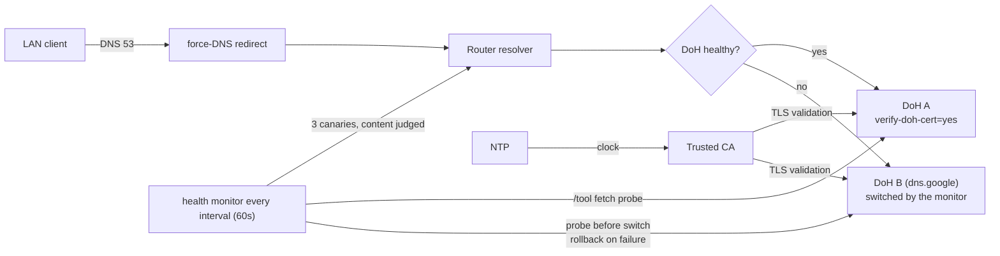

# mikrotik-doh-failover

<!-- md-i18n:switcher -->
**На других языках:** [English](README.md) · [Deutsch](README.de.md) · [中文](README.zh.md) · [हिन्दी](README.hi.md) · [Español](README.es.md) · Русский

**Отказоустойчивая конфигурация DNS-over-HTTPS (DoH) для MikroTik RouterOS в виде `.rsc`-скриптов, пригодных для diff.**

[**Документация**](docs/) · [**Релизы**](https://github.com/paulmann/mikrotik-doh-failover/releases) · [**История изменений**](CHANGELOG.md) · [**Проблемы**](https://github.com/paulmann/mikrotik-doh-failover/issues) · [**Безопасность**](SECURITY.md) · [**Для агентов**](AGENTS.md)

[](LICENSE)
[](https://github.com/paulmann/mikrotik-doh-failover/releases)
[](https://help.mikrotik.com/docs/spaces/ROS/pages/37748767/DNS)


RouterOS пропускает DNS локальной сети через роутер, но по умолчанию этот участок до
апстрима идёт открытым текстом. Этот проект настраивает **один проверенный** DoH-апстрим
с резервным вторым DoH-эндпоинтом, принудительно направляет классический DNS локальной
сети на роутер и добавляет плановую проверку состояния, которая при сбое переключается
на второй эндпоинт, проверяет переключение и возвращается на основной после
восстановления. Это сопровождение «как воспроизвести и поддерживать» к статье
[«Архитектура отказоустойчивого DNS-over-HTTPS в RouterOS»](https://sysadministrator.ru/%d0%b0%d1%80%d1%85%d0%b8%d1%82%d0%b5%d0%ba%d1%82%d1%83%d1%80%d0%b0-%d0%be%d1%82%d0%ba%d0%b0%d0%b7%d0%be%d1%83%d1%81%d1%82%d0%be%d0%b9%d1%87%d0%b8%d0%b2%d0%be%d0%b3%d0%be-dns-over-https-%d0%b2-routeros/)
на `sysadministrator.ru`.

> **Состояние документации.** Покрытая версия — **0.2.0** (тег `v0.2.0`,
> 2026-10-26). Числа в разделе «В цифрах» измерены `git ls-files` и
> `Get-ChildItem` на ветке `main` 2026-10-26, после прохода документации под
> 0.2.0. Поведение
> проверено на RouterOS 7.23.1 и 7.24.5; всё, что не проверено на устройстве,
> помечено в тексте, а `device-mode` назван там, где он меняет результат.

---

## Содержание

- [Что это и зачем](#что-это-и-зачем)
- [Что изменилось в 0.2.0](#что-изменилось-в-020)
- [Возможности](#возможности)
- [В цифрах](#в-цифрах)
- [Как это работает](#как-это-работает)
- [Установка](#установка)
- [Первые шаги](#первые-шаги)
- [Надёжность и ограничения](#надёжность-и-ограничения)
- [Безопасность](#безопасность)
- [Требования и совместимость](#требования-и-совместимость)
- [Документация](#документация)
- [Участие](#участие)
- [Лицензия](#лицензия)

---

## Что это и зачем

Распространённый неработающий подход к «DoH на MikroTik» — добавить несколько
DoH-серверов через `/ip dns static-server type=doh` и ждать от них резервирования.
Такого синтаксиса нет, и резервирования он не даёт: RouterOS поддерживает ровно
**один** `use-doh-server`. Другая частая ошибка — `verify-doh-cert=yes` без
доверенного CA: разрешение имён при этом молча останавливается полностью.

Проект обходит и то, и другое:

- **один активный DoH-апстрим** — по умолчанию обычный Cloudflare, без фильтрации;
  обычные `servers` служат только загрузкой (bootstrap) и никогда не работают как
  откат;
- **управляемый скрипт отказоустойчивости**, который при сбое переключается на
  второй DoH-эндпоинт, проверяет переключение и возвращается на основной после
  восстановления;
- **явный импорт CA** — проверено, что встроенное хранилище доверия не покрывает
  цепочку Cloudflare на 7.23/7.24;
- **статические A-записи для загрузки обоих хостов** — основного и резервного, чтобы
  проверка могла дойти до них, даже когда резолвер уже мёртв.

## Что изменилось в 0.2.0

Версия 0.1.0 ошибалась в том, что видно только в поле: она считала резолвер здоровым,
когда ответом была пара `8.6.112.0` / `8.47.69.0`, а из части сетей эта пара
недостижима — страницы перестают открываться, а монитор рапортует «всё хорошо».
0.2.0 меняет пять вещей (полный текст:
[`docs/release-notes-v0.2.0.md`](docs/release-notes-v0.2.0.md)):

| Изменение | Было (0.1.0) | Стало (0.2.0) |
|---|---|---|
| Апстрим по умолчанию | Cloudflare Family (`family.cloudflare-dns.com`, с фильтрацией) | Cloudflare **standard** (`cloudflare-dns.com`, 1.1.1.1/1.0.0.1); фильтрация — опция |
| Куда переключаемся | откат в обычный DNS | второй **DoH**-эндпоинт (`dns.google`) |
| Проверка состояния | любой валидный IP считался здоровым | судится **содержимое** ответа по трём канарейкам |
| Зонд эндпоинта | переключал `use-doh-server` (сеть теряла DoH на каждой проверке) | `/tool fetch` к DNS-JSON API, `/ip dns` не трогается |
| Неудачное переключение | роутер оставался на мёртвом эндпоинте | зонд до переключения, проверка после, откат при неудаче |

Обновление с 0.1.0 требует двух шагов сверх копирования скриптов: очистить старые
глобалы состояния (`DNSMonitorState`, `DNSFailoverAttempts`) и осознанно решить,
нужна ли фильтрация обратно — для этого нужны адрес Family, соответствующие
`servers` и CA из `examples/cloudflare-family.rsc`. Флаг `filtering` в
`05-dns-health-monitor.rsc` — только пометка для читателя: скрипт его объявляет и
нигде не читает, поэтому от него не зависит ни поведение, ни строка в журнале
(замерено 2026-10-26). Глобала `DNSCurrentMode` из 0.1.0 больше не существует.

## Возможности

| Возможность | Подробности |
|---|---|
| Шифрованный апстрим | один DoH-апстрим с `verify-doh-cert=yes` |
| Откат | второй **DoH**-эндпоинт (Google), когда основной недоступен |
| Восстановление | автоматический возврат на основной после успешной проверки |
| Проверка состояния | судит ОТВЕТ по содержимому, а не по типу; опрос эндпоинтов через `/tool fetch` |
| Загрузка | статические A-записи для обоих хостов эндпоинтов |
| Принудительный классический DNS | `dstnat redirect` для UDP/TCP 53 с моста локальной сети |
| Защита резолвера | отбрасывать DNS из WAN, принимать из локальной сети (UDP и TCP) |
| Политика скрипта | только `read,write,policy,test` (без `ftp`/`reboot`/`password`) |
| Мониторинг парка | коллектор Zabbix 8 для состояния DoH и VPN по SSH — `zabbix/`, на `main` после тега `v0.2.0` |

## В цифрах

Измерено на `main`, 2026-10-26:

| Что считается | Количество | Откуда измерено |
|---|---|---|
| Скрипты RouterOS | 7 (360 строк) | `routeros/*.rsc` |
| Примеры конфигураций | 2 | `examples/*.rsc` |
| Документы | 5 | `docs/*.md` |
| Схемы | 3 | `diagrams/*.mmd` |
| Языки README | 6 | `README*.md` |
| Файлов под git | 38 | `git ls-files` |
| Проверенных устройств | 6 | `docs/verification.md`, таблица ниже |
| Проверенных версий RouterOS | 2 (7.23.1, 7.24.5) | `docs/verification.md` |
| Объекты Zabbix | 8 элементов, 5 триггеров, 2 дерева сервисов | `zabbix/doh-zabbix-setup.py` |

Сам тег `v0.2.0` содержит 32 файла; всё, что лежит в `zabbix/`, закоммичено
после тега, поэтому на `main` оно есть, а в релизе — нет.

## Как это работает



Монитор никогда не переключает `use-doh-server`, чтобы что-то проверить: зонд — это
HTTPS-запрос через `/tool fetch`, поэтому обычная проверка не трогает `/ip dns`.
Состояния (схема: [`diagrams/dns-failover.mmd`](diagrams/dns-failover.mmd)) —
`healthy` → `suspect` → `fallback` → `recovering` → `healthy`, запись в журнал только при переходе.

| Компонент | Задача |
|---|---|
| `00-install-ca.rsc` | якорь доверия для `verify-doh-cert=yes` |
| `01-configure-doh.rsc` | один DoH-апстрим + загрузка обоих хостов |
| `02-security-policies.rsc` | принудительный классический DNS + защита резолвера |
| `03-capsman.rsc` | точечная интеграция с CAPsMAN/DHCP |
| `04-cert-update.rsc` | необязательное обновление CA |
| `05-dns-health-monitor.rsc` | проверка содержимого + переключение DoH→DoH (`maxAttempts=3`) |

## Установка

Требования:

- RouterOS **7.20+** по заявлению; поведение проверено только на **7.23.1** и
  **7.24.5**;
- синхронизированное время по NTP;
- `device-mode` `advanced` для автоматического **планировщика**.

Быстрый старт (обычный Cloudflare без фильтрации — умолчание с 0.2.0):

```rsc
# 1. Upload certs/cloudflare-doh-ca.crt to the router, then:
/import file-name=00-install-ca.rsc
/import file-name=01-configure-doh.rsc
/import file-name=02-security-policies.rsc
/import file-name=05-dns-health-monitor.rsc
```

Для других провайдеров (Quad9, Google, Cloudflare standard/security) измените
значения в [`routeros/config.example.rsc`](routeros/config.example.rsc). Ссылки на
raw-файлы лучше закреплять за `v0.2.0` (или коммитом), а не за `main`: `main` идёт
впереди тега.

## Первые шаги

```rsc
/ip dns cache flush
:put [:resolve example.com]     # ожидается 104.20.x / 172.66.x
                                # 8.6.112.0 / 8.47.69.0 — это «пара-заглушка», а не авария:
                                # см. docs/troubleshooting.md §6.10
:put [:resolve pornhub.com]     # с обычным резолвером — реальный адрес;
                                # 0.0.0.0 только с Family/Security
/log print where message~"connection error"
```

## Надёжность и ограничения

| Ситуация | Поведение |
|---|---|
| DoH недоступен | монитор переключается на резервный DoH, проверяет его и откатывается при неудаче (`error`/`warning`) |
| DoH восстановился | монитор возвращается на основной (`warning`) |
| Недоступны оба эндпоинта | монитор оставляет текущую конфигурацию и один раз пишет `error` |
| Ответы — «пара-заглушка» | монитор пишет это один раз и **не** переключается: второй эндпоинт вернёт ту же пару (§6.10) |
| Неверные часы | монитор пишет `clock looks wrong …` и прекращает работу: при неверной дате проверка сертификата невозможна |
| Переключение не удаётся | не больше 3 попыток на инцидент, дальше монитор ждёт восстановления основного, а не забивает журнал |
| Клиент использует свой DoH/DoT | **не блокируется** (задокументированное ограничение) |
| `device-mode=home` | `fetch` и планировщик отклоняются; монитор запускается вручную |

### Планировщик отклонён: `not allowed by device-mode`

На устройствах с `device-mode=home` (например, на проверенном здесь RB4011iGS+)
RouterOS отклоняет `/system scheduler add` и `/tool fetch` с сообщением
`not allowed by device-mode`. Это ожидаемое ограничение RouterOS, а не дефект
скрипта: конфигурация DoH и принудительный DNS работают, но монитор
отказоустойчивости можно запускать только вручную, и без `fetch` он вообще не может
опрашивать эндпоинты — тогда он сохраняет текущую конфигурацию.

1. оставить `home` и запускать `/system script run DNS_HealthMonitor_Failover` вручную;
2. перейти на `advanced`, чтобы включить планировщик:
   ```rsc
   /system/device-mode/update device-mode=advanced
   ```
   затем подтвердить изменение и перезагрузить устройство.

## Безопасность

- Резолвер отбрасывает DNS из WAN и перенаправляет только классический DNS (53); то,
  что клиент может обойти это своим DoH (443) или DoT (853), описано, а не скрыто.
- Выбор Cloudflare/Quad9/Google означает доверие этого третьего лица к своим запросам;
  DoH скрывает их только от локального участка.
- Загрузка CA — только из доверенного источника; `check-certificate=no` допустим
  исключительно на время загрузки.
- Резервный эндпоинт обязан отвечать на DNS-JSON API: с Quad9 в резерве он всегда
  выглядел бы недоступным (`docs/troubleshooting.md` §6.12).
- Отчёты об уязвимостях и модель безопасности — в [SECURITY.md](SECURITY.md).

## Требования и совместимость

| Устройство | RouterOS | device-mode | Беспроводной стек | Результат |
|---|---|---|---|---|
| Chateau PRO ax | 7.24.5 | advanced | прежний `/caps-man` (контроллер) | проверено (хаб) |
| cAP ax | 7.24.5 | advanced | прежний `/caps-man` (клиент) | проверено |
| RB4011iGS+ | 7.24.5 | home | — | проверено; планировщик заблокирован |
| hAP ax² | 7.24.5 | advanced | — | проверено |
| RB951Ui-2HnD | 7.24.5 | advanced | — | проверено |
| RB2011UiAS | 7.23.1 | advanced | — | проверено |

## Документация

| Документ | Содержание |
|---|---|
| [`docs/architecture.md`](docs/architecture.md) | обоснование решений, таблица состояний, модель угроз |
| [`docs/verification.md`](docs/verification.md) | проверки по подсистемам + восемь сценариев переключения |
| [`docs/troubleshooting.md`](docs/troubleshooting.md) | известные отказы и обходы, включая §6.10 («пара-заглушка») |
| [`docs/release-notes-v0.2.0.md`](docs/release-notes-v0.2.0.md) | что изменила 0.2.0 и на каких замерах |
| [`zabbix/README.md`](zabbix/README.md) | мониторинг парка в Zabbix: состояние DoH и VPN, триггеры, дерево сервисов |
| [`routeros/config.example.rsc`](routeros/config.example.rsc) | все настраиваемые значения |
| [`AGENTS.md`](AGENTS.md) | тот же контракт, написанный для машинного исполнителя |

## Участие

Прочитайте [CONTRIBUTING.md](CONTRIBUTING.md). Вопросы безопасности —
[SECURITY.md](SECURITY.md), никогда не публичный issue.

## Лицензия

[MIT](LICENSE) © 2026 Mikhail Deynekin.
