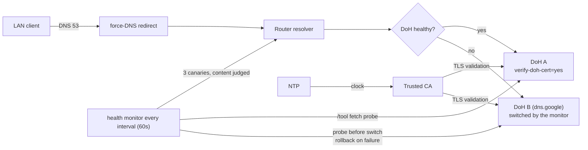

# mikrotik-doh-failover

<!-- md-i18n:switcher -->
**其他语言版本：** [English](README.md) · [Deutsch](README.de.md) · 中文 · [हिन्दी](README.hi.md) · [Español](README.es.md) · [Русский](README.ru.md)

**MikroTik RouterOS 的容错 DNS-over-HTTPS（DoH）配置，以可 diff 的 `.rsc` 脚本形式提供。**

[**文档**](docs/) · [**发布**](https://github.com/paulmann/mikrotik-doh-failover/releases) · [**变更日志**](CHANGELOG.md) · [**问题**](https://github.com/paulmann/mikrotik-doh-failover/issues) · [**安全**](SECURITY.md) · [**面向 agent**](AGENTS.md)

[](LICENSE)
[](https://github.com/paulmann/mikrotik-doh-failover/releases)
[](https://help.mikrotik.com/docs/spaces/ROS/pages/37748767/DNS)


RouterOS 会让局域网的 DNS 全部经由路由器转发，但默认情况下这段上游链路是明文的。本项目配置一个**经过校验的** DoH 上游，并以第二个经过校验的 DoH 端点作为 failover，强制局域网的传统 DNS 走路由器，并增加一个定时的健康检查，在失败时切换端点。它是 `sysadministrator.ru` 上文章
[«Архитектура отказоустойчивого DNS-over-HTTPS в RouterOS»](https://sysadministrator.ru/%d0%b0%d1%80%d1%85%d0%b8%d1%82%d0%b5%d0%ba%d1%82%d1%83%d1%80%d0%b0-%d0%be%d1%82%d0%ba%d0%b0%d0%b7%d0%be%d1%83%d1%81%d1%82%d0%be%d0%b9%d1%87%d0%b8%d0%b2%d0%be%d0%b3%d0%be-dns-over-https-%d0%b2-routeros/)
的“如何复现并维护”配套材料。

> **文档状态。** 覆盖版本：**0.2.0**（标签 `v0.2.0`，
> 2026-10-26）。“数字一览”中的计数由 `git ls-files` 和
> `Get-ChildItem` 在 `main` 上于 2026-10-26 测得（0.2.0 文档整理之后）。行为已在
> RouterOS 7.23.1 和 7.24.5 上验证；未在设备上验证的内容在正文中
> 已如此标注，凡会改变结果的 `device-mode` 取值都单独指出。

---

## 目录

- [这是什么，以及为什么需要它](#这是什么以及为什么需要它)
- [0.2.0 有哪些变化](#020-有哪些变化)
- [能力](#能力)
- [数字一览](#数字一览)
- [工作原理](#工作原理)
- [安装](#安装)
- [第一步](#第一步)
- [可靠性与限制](#可靠性与限制)
- [安全](#安全)
- [要求与兼容性](#要求与兼容性)
- [文档](#文档)
- [参与贡献](#参与贡献)
- [许可证](#许可证)

---

## 这是什么，以及为什么需要它

在 MikroTik 上实现 DoH 的一种常见错误做法，是用
`/ip dns static-server type=doh` 添加多个 DoH 服务器，并指望它们互为备份。这样的语法并不存在，
也不会带来冗余；RouterOS 只支持**一个** `use-doh-server`。
另一种常见故障是在没有受信任 CA 的情况下设置 `verify-doh-cert=yes`，这会让所有解析
静默停止。

本项目避开这两种做法：

- **只保留一个活动 DoH 上游** —— 默认使用不带过滤的标准 Cloudflare；
  plain `servers` 仅用于 bootstrap，永远不会被当作可用的回退；
- **一个受管的 failover** 脚本，在失败时切换到第二个 DoH 端点，
  验证切换结果，并在恢复后切回主端点；
- **显式导入 CA** —— 已确认内置信任库在 7.23/7.24 上
  并不覆盖 Cloudflare 证书链；
- **为两个端点主机名配置 bootstrap 静态 A 记录**，这样即使 resolver 本身已经失效，
  健康探测也能到达它们。

## 0.2.0 有哪些变化

0.1.0 版本有一个在实际现场会造成后果的错误：当应答是 `8.6.112.0` / `8.47.69.0` 这一对地址时，
它把 resolver 判为健康——而有些网络根本访问不到这一对地址，于是页面打不开，
监控却报告“一切正常”。0.2.0 改了五处（全文见
[`docs/release-notes-v0.2.0.md`](docs/release-notes-v0.2.0.md)）：

| 变化 | 之前（0.1.0） | 现在（0.2.0） |
|---|---|---|
| 默认上游 | Cloudflare Family（`family.cloudflare-dns.com`，带过滤） | Cloudflare **标准**版（`cloudflare-dns.com`，1.1.1.1/1.0.0.1）；过滤改为可选 |
| failover 目标 | 回退到 plain DNS | 第二个 **DoH** 端点（`dns.google`） |
| 健康检查 | 任何合法 IP 都算健康 | 通过三个金丝雀探针判定应答**内容** |
| 端点探测 | 切换 `use-doh-server`（每次检查都让局域网失去 DoH） | 用 `/tool fetch` 请求 DNS-JSON API，`/ip dns` 保持不变 |
| failover 失败 | 路由器停留在已失效的端点上 | 切换前先探测，切换后验证，失败则回滚 |

从 0.1.0 升级，除复制脚本外还需要两步：清除旧的状态全局变量
（`DNSMonitorState`、`DNSFailoverAttempts`），并明确决定是否要恢复过滤：这意味着使用 Family 的地址、对应的 `servers` 以及
`examples/cloudflare-family.rsc` 中的 CA。`05-dns-health-monitor.rsc` 里的 `filtering`
只是一个给读者看的标记：脚本声明了它，但从未读取，因此行为和日志都不依赖它（2026-10-26 实测）。0.1.0 的全局变量 `DNSCurrentMode` 已不存在。

## 能力

| 能力 | 说明 |
|---|---|
| 加密上游 | 一个 DoH 上游，启用 `verify-doh-cert=yes` |
| 回退 | 主端点不可达时使用第二个 **DoH** 端点（Google） |
| 恢复 | 健康检查通过后自动切回主端点 |
| 健康检查 | 判定 ANSWER（内容），而不是记录类型；用 `/tool fetch` 探测端点 |
| Bootstrap | 为两个端点主机名配置静态 A 记录 |
| 强制传统 DNS | 对来自 LAN 网桥的 UDP/TCP 53 做 `dstnat redirect` |
| resolver 保护 | 丢弃来自 WAN 的 DNS，接受来自 LAN 的请求（UDP 和 TCP） |
| failover 策略 | 仅 `read,write,policy,test`（不含 `ftp`/`reboot`/`password`） |
| 集群监控 | 通过 SSH 采集 DoH 与 VPN 状态的 Zabbix 8 采集器 —— `zabbix/`，位于 `v0.2.0` 标签之后的 `main` 上 |

## 数字一览

在 `main` 上测得，2026-10-26：

| 对象 | 数量 | 测量来源 |
|---|---|---|
| RouterOS 脚本 | 7（360 行） | `routeros/*.rsc` |
| 示例配置 | 2 | `examples/*.rsc` |
| 文档 | 5 | `docs/*.md` |
| 图表 | 3 | `diagrams/*.mmd` |
| README 语言 | 6 | `README*.md` |
| git 跟踪的文件 | 38 | `git ls-files` |
| 测试过的设备 | 6 | `docs/verification.md`，见下表 |
| 测试过的 RouterOS 版本 | 2（7.23.1、7.24.5） | `docs/verification.md` |
| Zabbix 对象 | 8 个 item、5 个 trigger、2 棵服务树 | `zabbix/doh-zabbix-setup.py` |

`v0.2.0` 标签本身包含 32 个文件；`zabbix/` 下的内容在该标签之后才提交，
因此在下一个版本之前，它在 `main` 上属于未发布内容。

## 工作原理



监控器从不通过切换 `use-doh-server` 来测试端点：探测是从 `/tool fetch` 发出的
HTTPS 请求，因此例行检查不会改动 `/ip dns`。状态机
（图见 [`diagrams/dns-failover.mmd`](diagrams/dns-failover.mmd)）
为 `healthy` → `suspect` → `fallback` → `recovering` → `healthy`，只在状态跃迁时记录日志。

| 组件 | 职责 |
|---|---|
| `00-install-ca.rsc` | `verify-doh-cert=yes` 的信任锚点 |
| `01-configure-doh.rsc` | 一个 DoH 上游 + 两个端点主机名的 bootstrap |
| `02-security-policies.rsc` | 强制传统 DNS + resolver 保护 |
| `03-capsman.rsc` | 定向的 CAPsMAN/DHCP 集成 |
| `04-cert-update.rsc` | 可选的 CA 刷新 |
| `05-dns-health-monitor.rsc` | 内容检查 + DoH 到 DoH 的 failover（`maxAttempts=3`） |

## 安装

要求：

- 按声明支持 RouterOS **7.20+**；行为仅在 **7.23.1** 和
  **7.24.5** 上验证；
- NTP 已同步；
- 自动 failover **调度器**需要 `device-mode` 为 `advanced`。

快速开始（标准 Cloudflare，不带过滤 —— 0.2.0 起的默认值）：

```rsc
# 1. Upload certs/cloudflare-doh-ca.crt to the router, then:
/import file-name=00-install-ca.rsc
/import file-name=01-configure-doh.rsc
/import file-name=02-security-policies.rsc
/import file-name=05-dns-health-monitor.rsc
```

如需使用其他提供商（Quad9、Google、Cloudflare 标准/安全版），请修改
[`routeros/config.example.rsc`](routeros/config.example.rsc) 中的取值。把 raw URL
固定到 `v0.2.0`（或某个提交）比固定到 `main` 更稳妥；`main` 领先于该标签。

## 第一步

```rsc
/ip dns cache flush
:put [:resolve example.com]     # expect 104.20.x / 172.66.x
                                # 8.6.112.0 / 8.47.69.0 is the "stub pair", not an outage:
                                # see docs/troubleshooting.md §6.10
:put [:resolve pornhub.com]     # a real IP with the standard resolver;
                                # 0.0.0.0 only with Family/Security
/log print where message~"connection error"
```

## 可靠性与限制

| 情况 | 行为 |
|---|---|
| DoH 不可达 | 监控器切换到备用 DoH，验证它，失败则回滚（记录 `error`/`warning`） |
| DoH 恢复 | 监控器切回主端点（记录 `warning`） |
| 两个端点都不可用 | 监控器保持当前配置，只记录一次 `error` |
| 应答是 stub 对 | 监控器记录一次，**不**执行 failover —— 第二个端点会返回同一对地址（§6.10） |
| 时钟错误 | 监控器记录 `clock looks wrong …` 并停止，因为日期错误时证书校验无法成功 |
| failover 反复失败 | 每次故障最多尝试 3 次，之后监控器等待主端点恢复，而不是刷满日志 |
| 客户端使用自己的 DoH/DoT | **不拦截**（已说明的限制） |
| `device-mode=home` | `fetch` 和调度器被拒绝；需手动运行监控器 |

### 调度器被拒绝：`not allowed by device-mode`

在 `device-mode=home` 的设备上（例如这里测试过的 RB4011iGS+），
RouterOS 会以 `not allowed by device-mode` 拒绝 `/system scheduler add` 和
`/tool fetch`。这是 RouterOS 的预期限制，不是脚本缺陷：
DoH 配置和 force-DNS 仍然可用，但 failover 监控器只能手动运行，
而且没有 `fetch` 就无法探测端点——此时它会保持当前配置。

1. 先从 `home` 切出，手动运行 `/system script run DNS_HealthMonitor_Failover`；
2. 切换到 `advanced` 以启用调度器：
   ```rsc
   /system/device-mode/update device-mode=advanced
   ```
   然后确认变更并重启。

## 安全

- resolver 丢弃来自 WAN 的 DNS，只重定向传统 DNS（53）；客户端绕过
  DoH（443）和 DoT（853）的情况已被记录，而不是隐藏。
- 选择 Cloudflare/Quad9/Google，意味着把你的查询托付给该第三方；
  DoH 只是把它们对本地链路隐藏起来。
- CA bootstrap 必须使用受信任的来源；`check-certificate=no` 仅用于 bootstrap。
- failover 目标必须是一个能应答 DNS-JSON API 的 DoH 端点——
  Quad9 作为回退会始终显得不可达（`docs/troubleshooting.md` §6.12）。
- 报告方式与安全模型见 [SECURITY.md](SECURITY.md)。

## 要求与兼容性

| 设备 | RouterOS | device-mode | 无线协议栈 | 结果 |
|---|---|---|---|---|
| Chateau PRO ax | 7.24.5 | advanced | 旧版 `/caps-man`（controller） | 已验证（hub） |
| cAP ax | 7.24.5 | advanced | 旧版 `/caps-man`（client） | 已验证 |
| RB4011iGS+ | 7.24.5 | home | — | 已验证；调度器被阻止 |
| hAP ax² | 7.24.5 | advanced | — | 已验证 |
| RB951Ui-2HnD | 7.24.5 | advanced | — | 已验证 |
| RB2011UiAS | 7.23.1 | advanced | — | 已验证 |

## 文档

| 文档 | 内容 |
|---|---|
| [`docs/architecture.md`](docs/architecture.md) | 设计理由、状态表、威胁模型 |
| [`docs/verification.md`](docs/verification.md) | 各子系统的检查 + 八个 failover 场景 |
| [`docs/troubleshooting.md`](docs/troubleshooting.md) | 已知故障与解决办法，含 §6.10（stub 对） |
| [`docs/release-notes-v0.2.0.md`](docs/release-notes-v0.2.0.md) | 0.2.0 改了什么，以及背后的测量数据 |
| [`zabbix/README.md`](zabbix/README.md) | Zabbix 中的集群监控：DoH 与 VPN 状态、trigger、服务树 |
| [`routeros/config.example.rsc`](routeros/config.example.rsc) | 全部可调参数 |
| [`AGENTS.md`](AGENTS.md) | 同一份约定，面向机器调用者撰写 |

## 参与贡献

请阅读 [CONTRIBUTING.md](CONTRIBUTING.md)。安全问题：见 [SECURITY.md](SECURITY.md)，
绝不要开公开 issue。

## 许可证

[MIT](LICENSE) © 2026 Mikhail Deynekin.
