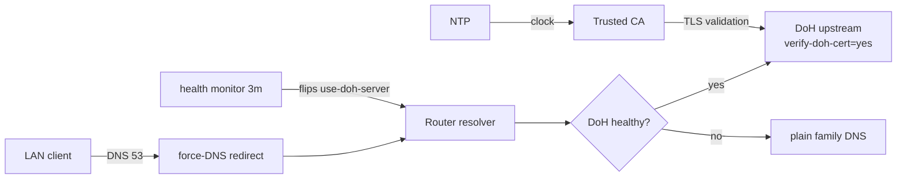

# mikrotik-doh-failover

<!-- md-i18n:switcher -->
**其他语言：** [English](README.md) · [Deutsch](README.de.md) · 中文 · [हिन्दी](README.hi.md) · [Español](README.es.md) · [Русский](README.ru.md)

**面向 MikroTik RouterOS 的故障切换 DNS-over-HTTPS（DoH）配置，以可 diff 的 `.rsc` 脚本形式提供。**

[**文档**](docs/) · [**版本发布**](https://github.com/paulmann/mikrotik-doh-failover/releases) · [**变更日志**](CHANGELOG.md) · [**问题反馈**](https://github.com/paulmann/mikrotik-doh-failover/issues) · [**安全**](SECURITY.md) · [**供代理使用**](AGENTS.md)

[](LICENSE)
[](https://github.com/paulmann/mikrotik-doh-failover/releases)
[](https://help.mikrotik.com/docs/spaces/ROS/pages/37748767/DNS)


RouterOS 让局域网的 DNS 全部经过路由器，但默认情况下这一段上游链路是明文。
本项目只配置**一个经过验证的** DoH 上游，并用明文 DNS 作为回退；
把传统的局域网 DNS 强制指向路由器；再加一个定时健康检查，
在故障时于 DoH 与明文 DNS 之间切换。
它是对文章
[«Архитектура отказоустойчивого DNS-over-HTTPS в RouterOS»](https://sysadministrator.ru/%d0%b0%d1%80%d1%85%d0%b8%d1%82%d0%b5%d0%ba%d1%82%d1%83%d1%80%d0%b0-%d0%be%d1%82%d0%ba%d0%b0%d0%b7%d0%be%d1%83%d1%81%d1%82%d0%be%d0%b9%d1%87%d0%b8%d0%b2%d0%be%d0%b3%d0%be-dns-over-https-%d0%b2-routeros/)
（发布在 `sysadministrator.ru`）的「如何复现与维护」配套材料。

> **文档状态。** 本 README 中的数字均于 2026-10-22（v0.1.0）从已发布的
> 代码树实测。长篇设计依据见 [`docs/`](docs/)；脚本已在 RouterOS 7.23.1
> 与 7.24.5 上验证。

---

## 目录

- [本项目的定位与理由](#本项目的定位与理由)
- [功能](#功能)
- [数字一览](#数字一览)
- [工作原理](#工作原理)
- [安装](#安装)
- [第一步](#第一步)
- [可靠性与限制](#可靠性与限制)
- [安全](#安全)
- [环境要求与兼容性](#环境要求与兼容性)
- [文档](#文档)
- [参与贡献](#参与贡献)
- [许可证](#许可证)

---

## 本项目的定位与理由

在「MikroTik 上做 DoH」这件事上，常见但行不通的做法是用
`/ip dns static-server type=doh` 添加多个 DoH 服务器，然后指望它带来冗余。
这个语法并不存在，也不会产生冗余：RouterOS 只支持**一个** `use-doh-server`。
另一个常见错误是在没有可信 CA 的情况下设置 `verify-doh-cert=yes`，
结果是所有解析静默停止。

本项目避开了这两点：

- **只有一个处于活动状态的 DoH 上游**，
  用普通的 `servers` 做引导与回退；
- **由脚本管理的故障切换**：失败时清空 `use-doh-server`，
  恢复后再装回去；
- **显式导入 CA**——已验证内置信任库在 7.23/7.24 上
  不包含 Cloudflare 的证书链；
- **引导用的静态 A 记录**，即使明文 DNS 不可用，DoH 主机名也能解析。

本 README 与 `docs/` 中的每一条结论都在真实设备上验证过；凡行为有差异之处，都写明
了版本与 `device-mode`。

## 功能

| 能力 | 说明 |
|---|---|
| 加密上游 | 一个 DoH 上游，带 `verify-doh-cert=yes` |
| 回退 | DoH 不可达时改用明文 Family DNS（`1.1.1.3,1.0.0.3`） |
| 恢复 | 健康检查通过后自动回到 DoH |
| 引导 | 为 DoH 主机名准备静态 A 记录 |
| 强制传统 DNS | 对局域网网桥来的 UDP/TCP 53 做 `dstnat redirect` |
| 解析器防护 | 丢弃来自 WAN 的 DNS，接受来自局域网的 DNS（UDP 与 TCP） |
| 切换策略 | 仅 `read,write,policy,test`（不用 `ftp`/`reboot`/`password`） |

## 数字一览

于 2026-10-22（v0.1.0）从已发布的代码树实测：

| 统计面 | 数量 | 实测来源 |
|---|---|---|
| RouterOS 脚本 | 7 | `routeros/` |
| 示例配置 | 1 | `examples/` |
| 文档 | 3 | `docs/` |
| 图示 | 3 | `diagrams/` |
| 已测试设备 | 5 | `docs/verification.md` |
| 已测试 RouterOS 版本 | 2（7.23.1、7.24.5） | `docs/verification.md` |

## 工作原理



| 组件 | 职责 |
|---|---|
| `00-install-ca.rsc` | 为 `verify-doh-cert=yes` 准备信任锚 |
| `01-configure-doh.rsc` | 一个 DoH 上游 + 引导 + 回退 |
| `02-security-policies.rsc` | 强制传统 DNS + 解析器防护 |
| `03-capsman.rsc` | 有针对性的 CAPsMAN/DHCP 集成 |
| `04-cert-update.rsc` | 可选的 CA 更新 |
| `05-dns-health-monitor.rsc` | 健康检查 + 故障切换调度 |

## 安装

要求：

- RouterOS **7.20+**（已在 7.23.1、7.24.5 验证）；
- NTP 已同步；
- `device-mode` 为 `advanced`，自动故障切换的**调度器**才可用。

快速开始（Cloudflare Family）：

```rsc
# 1. Upload certs/cloudflare-doh-ca.crt to the router, then:
/import file-name=00-install-ca.rsc
/import file-name=01-configure-doh.rsc
/import file-name=02-security-policies.rsc
/import file-name=05-dns-health-monitor.rsc
```

其他服务商（Quad9、Google、Cloudflare standard/security）请修改
[`routeros/config.example.rsc`](routeros/config.example.rsc) 中的取值。

## 第一步

```rsc
/ip dns cache flush
:put [:resolve example.com]     # real IP
:put [:resolve pornhub.com]     # 0.0.0.0 with the Family filter
/log print where message~"connection error"
```

## 可靠性与限制

| 情形 | 行为 |
|---|---|
| DoH 不可达 | 故障切换脚本改用明文 Family DNS（日志记 `error`） |
| DoH 恢复 | 脚本恢复 DoH（日志记 `warning`） |
| DoH 与明文 DNS 都失效 | 脚本保留最后一份配置并记 `critical` |
| 客户端自带 DoH/DoT | **不拦截**（已记录的边界） |
| `device-mode=home` | 调度器被拒绝；只能手动运行监视脚本 |

### 调度器被拒绝：`not allowed by device-mode`

在 `device-mode=home` 的设备上（例如本文测试的 RB4011iGS+），RouterOS 会以
`not allowed by device-mode` 拒绝 `/system scheduler add` 和 `/tool fetch`。
这是 RouterOS 的既定限制，不是脚本缺陷：DoH 配置与强制 DNS 依然可用，
只是故障切换监视只能手动运行。
可选做法：

1. 保留 `home`，手动运行 `/system script run DNS_HealthMonitor_Failover`；
2. 改成 `advanced` 以启用调度器：
   ```rsc
   /system/device-mode/update device-mode=advanced
   ```
   然后确认改动并重启。

## 安全

- 解析器丢弃来自 WAN 的 DNS，只重定向传统 DNS（53）；客户端自行使用 DoH（443）或
  DoT（853）可以绕过，这一点写在文档里，没有隐瞒。
- 选择 Cloudflare/Quad9/Google 意味着把自己的查询托付给该第三方；DoH 只把它对本地
  链路隐藏起来。
- CA 的引导必须来自可信来源；`check-certificate=no` 只用于引导阶段。
- 报告渠道与安全模型见 [SECURITY.md](SECURITY.md)。

## 环境要求与兼容性

| 设备 | RouterOS | device-mode | 无线协议栈 | 结果 |
|---|---|---|---|---|
| Chateau PRO ax | 7.24.5 | advanced | 旧版 `/caps-man`（控制器） | 已验证（中枢） |
| cAP ax | 7.24.5 | advanced | 旧版 `/caps-man`（客户端） | 已验证 |
| RB4011iGS+ | 7.24.5 | home | — | 已验证；调度器被拒 |
| hAP ax² | 7.24.5 | advanced | — | 已验证 |
| RB951Ui-2HnD | 7.24.5 | advanced | — | 已验证 |
| RB2011UiAS | 7.23.1 | advanced | — | 已验证 |

## 文档

| 文档 | 内容 |
|---|---|
| [`docs/architecture.md`](docs/architecture.md) | 设计依据与威胁模型 |
| [`docs/verification.md`](docs/verification.md) | 各子系统检查项 + 故障切换测试清单 |
| [`docs/troubleshooting.md`](docs/troubleshooting.md) | 已知故障与绕行办法 |
| [`routeros/config.example.rsc`](routeros/config.example.rsc) | 全部可调取值 |

## 参与贡献

先读 [CONTRIBUTING.md](CONTRIBUTING.md)。安全问题请走 [SECURITY.md](SECURITY.md)，
绝不要开公开的 issue。

## 许可证

[MIT](LICENSE) © 2026 Mikhail Deynekin.
