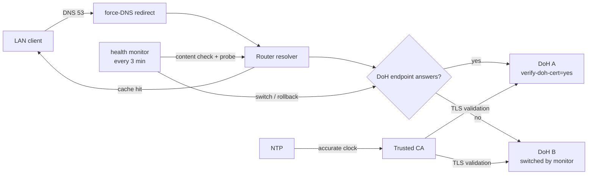

# Architecture

This document is the design rationale behind the `.rsc` scripts. It is written
to be reproducible and criticizable, not to over-promise.

## 1. Goal and honest scope

The goal is a RouterOS box whose DNS traffic to the provider is encrypted and
whose LAN clients are pushed through the router resolver, with an automatic
switch to a second encrypted endpoint when the first fails.

What the design **actually** guarantees:

- DNS queries sent by the **router** to the upstream travel over HTTPS (DoH) and
  the upstream's TLS certificate is verified.
- A single DoH upstream is active; when it stops answering the monitor switches
  to a second DoH endpoint, verifies that the switch works, and returns to the
  primary after recovery.
- Classic DNS (UDP/TCP 53) from the LAN is redirected to the router, so clients
  that obey DHCP/DNS get the router's resolver.

What it does **not** guarantee:

- It does **not** stop a client from using its own DoH (TCP 443), DoT (TCP 853)
  or hardcoded resolvers. Blocking DoT needs an extra rule (provided, commented);
  blocking client DoH over 443 needs a proxy/DPI.
- It does **not** make the resolver trustworthy by itself: choosing Cloudflare,
  Quad9 or Google is a decision to trust that third party.
- It does **not** make an unreachable answer reachable. If the upstream answers
  with addresses that this network cannot reach, DNS-level changes cannot fix
  that — see `docs/troubleshooting.md` §6.10.

## 2. Component map

## 3. Subsystems

### 3.1 Trust (CA)

`verify-doh-cert=yes` validates the DoH server's TLS chain against the router's
trust store. **Verified on 7.23.1 and 7.24.5:** with no trusted CA imported the
resolver fails, and because `use-doh-server` is the only path the whole network
loses DNS.

Two facts that differ from some blog guidance:

- The `/certificate settings` parameter is `builtin-trust-store` (default on
  these versions), **not** `builtin-trust-anchors`.
- The builtin trust store does **not** cover the Cloudflare DoH chain, so an
  explicit CA import is mandatory.

For Cloudflare the chain is `Cloudflare Inc → SSL.com → Comodo AAA`, so the
required root is **`SSL.com TLS ECC Root CA 2022`** (shipped in `certs/`).
Quad9 and Google need their own root CA — which matters for the fallback: if the
fallback host's CA is missing, `verify-doh-cert=yes` rejects it, the monitor sees
no resolution after switching and rolls back (and says so in the log).

### 3.2 DNS and redundancy

RouterOS supports exactly **one** active DoH server. There is no native
"backup DoH" and `/ip dns static-server type=doh` is not a real failover
mechanism. Redundancy is therefore:

- `servers=` — plain upstreams used **only** as bootstrap for the DoH hostname;
- static A records for **both** endpoint hostnames, so the monitor's HTTPS probe
  can reach them even when the resolver itself is dead (chicken-and-egg);
- the failover script, which switches the active endpoint to a second DoH.

Since 0.2.0 the fallback is another **DoH** endpoint, not plain DNS. Measured
2026-10-26 from two independent vantage points: plain queries — even straight to
`1.1.1.1` and `8.8.8.8` — came back with substituted answers, so "fall back to
plain" converts a visible outage into a silent one.

### 3.3 Security policies

- `dstnat action=redirect` (UDP **and** TCP 53) from the LAN bridge to the router.
  `redirect` is preferred over `dst-nat to-addresses=<router-ip>`: the latter can
  be flagged `invalid` and hardcodes an address.
- `input` accept for DNS from LAN (UDP **and** TCP — both are required because
  the NAT rule redirects both), and `input` drop for DNS from WAN so the router
  is not an open resolver.
- Optional `forward` drop of TCP 853 (DoT) to reduce bypass.

**Known limit (measured 2026-10-26):** redirect does not apply to clients that
already use the router as their resolver — their query is answered locally and
never enters `dstnat`. Per-client resolver policies built on dst-nat therefore do
not work for those clients; hand the resolver out over DHCP or run a separate
resolver instead.

### 3.4 CAPsMAN

Only for the legacy `/caps-man` stack and only on the controller. The example
targets **one** configuration by name (not `[find]`, which would change every
configuration) and sets the DHCP `dns-server` by the network's exact CIDR
address. Newer hardware uses `/interface wifi` (`wifi-qcom`/`wifi-qcom-ac`) and
should be configured there instead.

### 3.5 Monitoring and failover

The monitor runs every 3 minutes, keeps its state in two globals
(`DNSMonitorState`, `DNSFailoverAttempts`) and logs only on transitions, so a
broken resolver does not flood the log.

Two independent measurements per run:

1. **Are the answers usable?** Three canary names are resolved through the live
   resolver and the result is judged by content: empty, `0.0.0.0` and the stub
   pair `8.6.112.0`/`8.47.69.0` all count as unusable. v1 judged only the type
   (`ip`), which is why it called the stub pair healthy.
2. **Does each endpoint answer?** Both endpoints are probed with `/tool fetch`
   against their DNS-JSON API. This does not touch `/ip dns`, so a check no
   longer takes the LAN off DoH the way v1 did.

| State | Condition | Action | Log |
|---|---|---|---|
| `healthy` | at least one canary returns a real address | if on the fallback, switch back to primary; reset attempts | `info`/`warning` on transition |
| `stub` | answers are the stub pair | nothing — a second endpoint returns the same pair | `warning` once |
| `dead` | no usable answers, endpoint answering | flush cache, re-check next run | `warning` once |
| `failoverB` | primary unreachable, fallback probed OK, switch verified | stay on fallback; try to come home each run | `warning` once |
| `dead` (both) | neither endpoint reachable | keep the current configuration | `error` once |

A failover is attempted at most `maxAttempts` (3) times per outage; the fallback
is probed **before** switching and the switch is verified **after**, with an
automatic rollback to the primary if the fallback does not resolve. The router
therefore never ends up parked on a dead endpoint.

## 4. Threat model

- **Local attacker / passive ISP**: DoH hides query names and content from the
  local link; the router→provider leg is encrypted and authenticated.
- **Provider / DNS operator**: sees the plaintext DNS (after decryption at the
  DoH endpoint). The design does not add DNSSEC-verification of answers; TLS
  protects the transport, not the answer authenticity.
- **Answer substitution on the path**: measured in Russia for plain DNS; DoH is
  not affected, but a substituted *plain* fallback would go unnoticed without the
  content check.
- **MITM on the CA bootstrap**: mitigated by importing the specific CA from a
  trusted source and verifying its fingerprint; `check-certificate=no` is a
  one-time bootstrap only.

## 5. What "not distinguishable from HTTPS" really means

DoH runs over HTTPS/443, but SNI, destination IPs and traffic volume/patterns
can still identify it to a sophisticated observer. "Indistinguishable" is an
overstatement; "encrypted and authenticated" is accurate.
