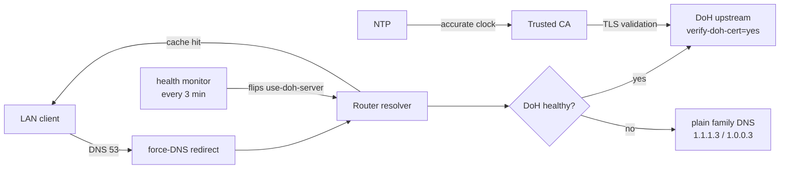

# Architecture

This document is the design rationale behind the `.rsc` scripts. It is written
to be reproducible and criticizable, not to over-promise.

## 1. Goal and honest scope

The goal is a RouterOS box whose DNS traffic to the provider is encrypted and
whose LAN clients are pushed through the router resolver, with an automatic
fallback when the encrypted path fails.

What the design **actually** guarantees:

- DNS queries sent by the **router** to the upstream travel over HTTPS (DoH) and
  the upstream's TLS certificate is verified.
- A single DoH upstream is active; on failure the router temporarily falls back
  to plain family DNS, then returns to DoH after recovery.
- Classic DNS (UDP/TCP 53) from the LAN is redirected to the router, so clients
  that obey DHCP/DNS get the filtered resolver.

What it does **not** guarantee:

- It does **not** stop a client from using its own DoH (TCP 443), DoT (TCP 853)
  or hardcoded resolvers. Blocking DoT needs an extra rule (provided, commented);
  blocking client DoH over 443 needs a proxy/DPI.
- It does **not** make the resolver trustworthy by itself: choosing Cloudflare,
  Quad9 or Google is a decision to trust that third party.

## 2. Component map

## 3. Subsystems

### 3.1 Trust (CA)

`verify-doh-cert=yes` validates the DoH server's TLS chain against the router's
trust store. **Verified on 7.23.1 and 7.24.5:** with no trusted CA imported the
resolver fails, and because `use-doh-server` is the only path the whole network
loses DNS.

Two facts that differ from some blog guidance:

- The `/certificate settings` parameter is `builtin-trust-store` (default on
  these versions), **not** `builtin-trust-anchors`.
- The builtin trust store does **not** cover the Cloudflare DoH chain, so an
  explicit CA import is mandatory.

For Cloudflare the chain is `Cloudflare Inc → SSL.com → Comodo AAA`, so the
required root is **`SSL.com TLS ECC Root CA 2022`** (shipped in `certs/`).
Quad9 and Google need their own root CA.

### 3.2 DNS and redundancy

RouterOS supports exactly **one** active DoH server. There is no native
"backup DoH" and `/ip dns static-server type=doh` is not a real failover
mechanism. Redundancy is therefore:

- `servers=1.1.1.3,1.0.0.3` — plain upstreams used as bootstrap and as fallback;
- static A records for the DoH hostname so it resolves even when plain DNS is
  down (breaks the chicken-and-egg dependency);
- the failover script, which clears `use-doh-server` on failure and restores it
  on recovery.

### 3.3 Security policies

- `dstnat action=redirect` (UDP **and** TCP 53) from the LAN bridge to the router.
  `redirect` is preferred over `dst-nat to-addresses=<router-ip>`: the latter can
  be flagged `invalid` and hardcodes an address.
- `input` accept for DNS from LAN (UDP **and** TCP — both are required because
  the NAT rule redirects both), and `input` drop for DNS from WAN so the router
  is not an open resolver.
- Optional `forward` drop of TCP 853 (DoT) to reduce bypass.

### 3.4 CAPsMAN

Only for the legacy `/caps-man` stack and only on the controller. The example
targets **one** configuration by name (not `[find]`, which would change every
configuration) and sets the DHCP `dns-server` by the network's exact CIDR
address. Newer hardware uses `/interface wifi` (`wifi-qcom`/`wifi-qcom-ac`) and
should be configured there instead.

### 3.5 Monitoring and failover

The monitor runs every 3 minutes and holds its state in a global variable.

| State | Condition | Action | Log |
|---|---|---|---|
| normal | DoH answers | keep DoH | — |
| DoH down | `:resolve` fails, plain answers | switch to plain | `error` |
| all down | both fail | keep last config, count | `critical` |
| recovered | DoH answers again | switch back to DoH | `warning` |

Checks use the real resolver path (`:resolve <domain>`), not an HTTP-status
heuristic: `:resolve <domain> server=1.1.1.3` issues a direct plain query and is
used to test the fallback independently of the broken DoH.

## 4. Threat model

- **Local attacker / passive ISP**: DoH hides query names and content from the
  local link; the router→provider leg is encrypted and authenticated.
- **Provider / DNS operator**: sees the plaintext DNS (after decryption at the
  DoH endpoint). The design does not add DNSSEC-verification of answers; TLS
  protects the transport, not the answer authenticity.
- **MITM on the CA bootstrap**: mitigated by importing the specific CA from a
  trusted source and verifying its fingerprint; `check-certificate=no` is a
  one-time bootstrap only.

## 5. What "not distinguishable from HTTPS" really means

DoH runs over HTTPS/443, but SNI, destination IPs and traffic volume/patterns
can still identify it to a sophisticated observer. "Indistinguishable" is an
overstatement; "encrypted and authenticated" is accurate.
